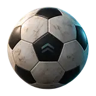

# TITAN — Bibliothèque visuelle sportive

## Mission
Refondre l'iconographie des **260 sports canoniques** pour Android (priorité) et Web. Créer une collection de pictogrammes 3D réalistes, premium, immédiatement reconnaissables et exploitables en production. Un objet/équipement principal par sport ; pas de personnages inutiles, pas de look futuriste ni de fond.

**Branche de travail** : `design/titan-sports-library-consolidation-20261112`. Aucune modification de `main` ni déploiement automatique.

## Nettoyage
Les anciens lots 01/02 de travail ont **déjà été retirés uniquement de cette branche**. Ils sont conservés sur `main` et dans `design/archive-titan-sports-library-20261112`. Ne pas recommencer le nettoyage ; ne pas supprimer de ressources utilisées par l'app.

## Football V05 : référence artistique approuvée

- Aperçu disponible : `v2/examples/football-v05-160.webp` (160 × 160, WebP avec alpha)
- **Référence artistique validée par le propriétaire** : ballon noir et blanc usé, cuir réaliste, reliefs et coutures crédibles, chevrons TITAN petits, mats, gris bleuté, presque ton sur ton.
- **Pas un master** : cette vignette de 160px ne doit jamais être agrandie pour créer un fichier 512px ou déployée comme visuel définitif. Original transparent 1254×1254 : `a_clean_isolated_product_style_render_transparent.png` (conversation d'origine ; à importer et vérifier).

## Ressources
- [Charte](CHARTER.md)
- [Instructions pour Work](INSTRUCTIONS-WORK.md)
- [Chantier V2](v2/README.md)
- [260 sports et lots B01–B26](v2/registry/canonical-sports.json)

Aucune nouvelle illustration n'est validée implicitement : **chaque sport/version exige une approbation explicite**, puis un master et des formats dérivés contrôlés.
