# TITAN — Galerie de revue des propositions global-v2

**Statut : PROPOSED — aucune illustration ici n'est validée ni déployée.**

Dépôt : Theo25460/TITAN_V0.5 · Branche : `design/titan-illustrations-global-v2-20261113` · 58 nouveaux masters vectoriels autonomes SVG · masters et exports WebP complémentaires prévus par `tools/render.mjs`.

Les visuels Renaissance historiques restent en production tant que la refonte n'est pas validée. Les pictogrammes sportifs et les abonnements sont exclus.

## P0 — Blasons de grades

| Aperçu | ID | Usage / statut |
|:--:|---|---|
| 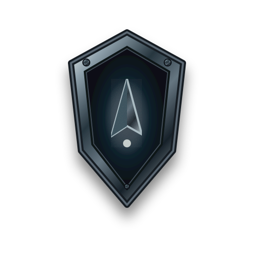 | [ranks-eclaireur](../proposed/masters/ranks/eclaireur.svg) | Éclaireur · **À approuver** |
| 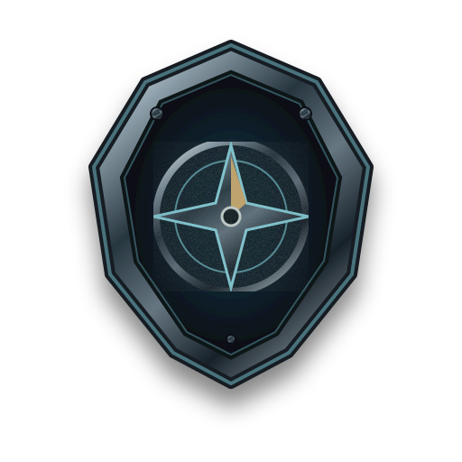 | [ranks-explorateur](../proposed/masters/ranks/explorateur.svg) | Explorateur · **À approuver** |
| 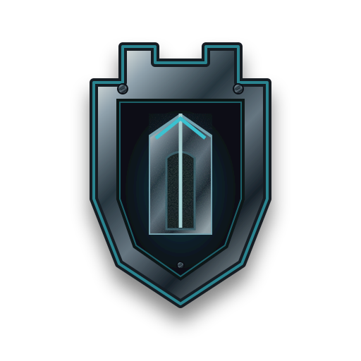 | [ranks-sentinelle](../proposed/masters/ranks/sentinelle.svg) | Sentinelle · **À approuver** |
| 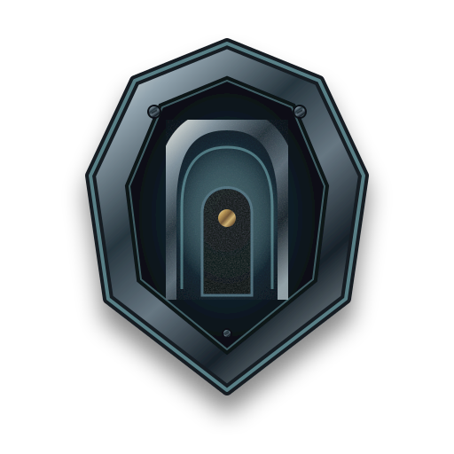 | [ranks-gardien](../proposed/masters/ranks/gardien.svg) | Gardien · **À approuver** |
| 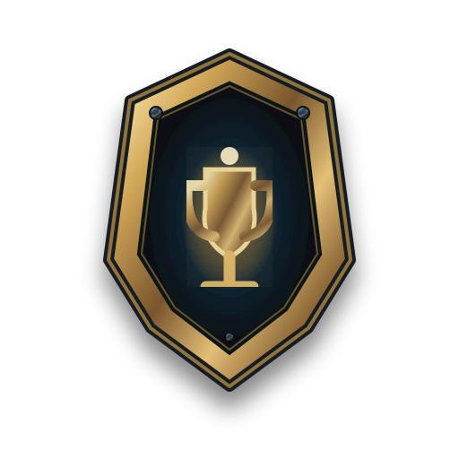 | [ranks-champion](../proposed/masters/ranks/champion.svg) | Champion · **À approuver** |
| 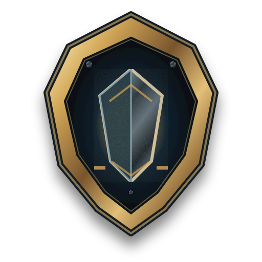 | [ranks-titan](../proposed/masters/ranks/titan.svg) | Titan · **À approuver** |
| 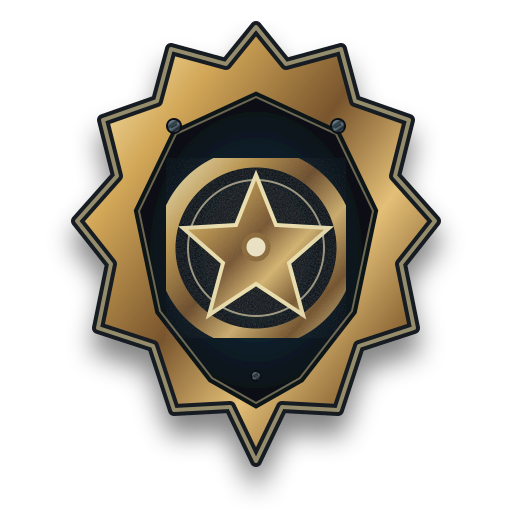 | [ranks-legende](../proposed/masters/ranks/legende.svg) | Légende · **À approuver** |

## P0 — Paliers visuels (n'affectent pas les niveaux métier)

| Aperçu | ID | Usage / statut |
|:--:|---|---|
| 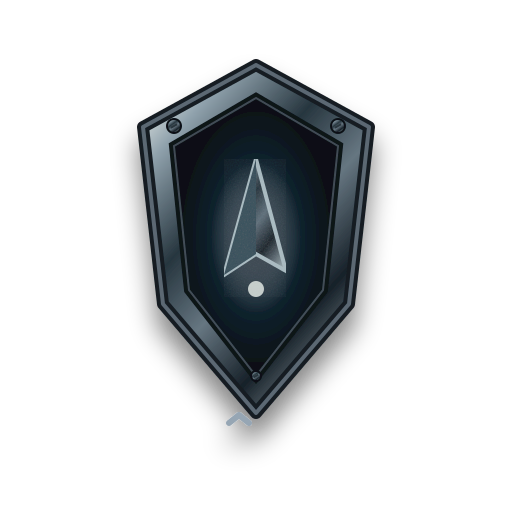 | [level-tiers-eclaireur-tier-1](../proposed/masters/level-tiers/eclaireur-tier-1.svg) | Éclaireur — palier 1 · **À approuver** |
| 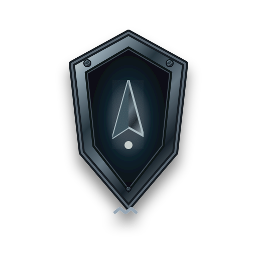 | [level-tiers-eclaireur-tier-2](../proposed/masters/level-tiers/eclaireur-tier-2.svg) | Éclaireur — palier 2 · **À approuver** |
| 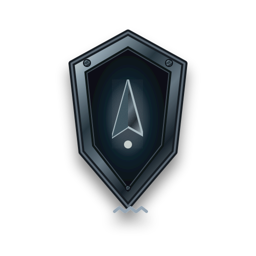 | [level-tiers-eclaireur-tier-3](../proposed/masters/level-tiers/eclaireur-tier-3.svg) | Éclaireur — palier 3 · **À approuver** |
|  | [level-tiers-explorateur-tier-1](../proposed/masters/level-tiers/explorateur-tier-1.svg) | Explorateur — palier 1 · **À approuver** |
| 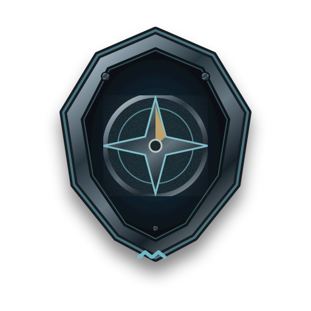 | [level-tiers-explorateur-tier-2](../proposed/masters/level-tiers/explorateur-tier-2.svg) | Explorateur — palier 2 · **À approuver** |
| 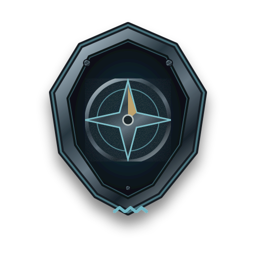 | [level-tiers-explorateur-tier-3](../proposed/masters/level-tiers/explorateur-tier-3.svg) | Explorateur — palier 3 · **À approuver** |
|  | [level-tiers-sentinelle-tier-1](../proposed/masters/level-tiers/sentinelle-tier-1.svg) | Sentinelle — palier 1 · **À approuver** |
| 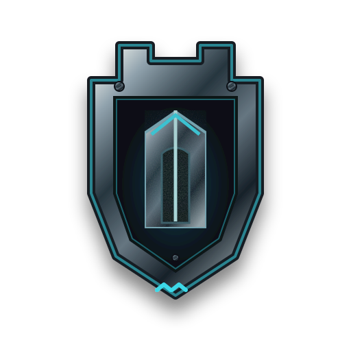 | [level-tiers-sentinelle-tier-2](../proposed/masters/level-tiers/sentinelle-tier-2.svg) | Sentinelle — palier 2 · **À approuver** |
| 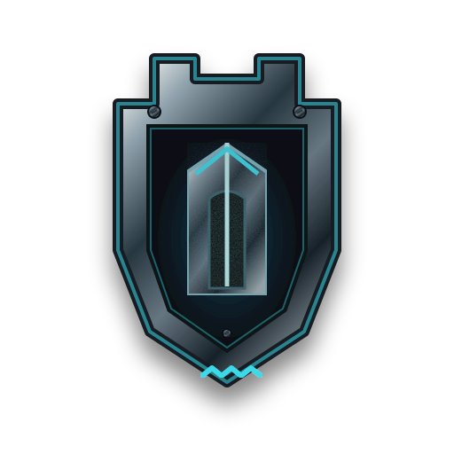 | [level-tiers-sentinelle-tier-3](../proposed/masters/level-tiers/sentinelle-tier-3.svg) | Sentinelle — palier 3 · **À approuver** |
| 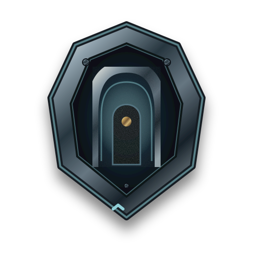 | [level-tiers-gardien-tier-1](../proposed/masters/level-tiers/gardien-tier-1.svg) | Gardien — palier 1 · **À approuver** |
| 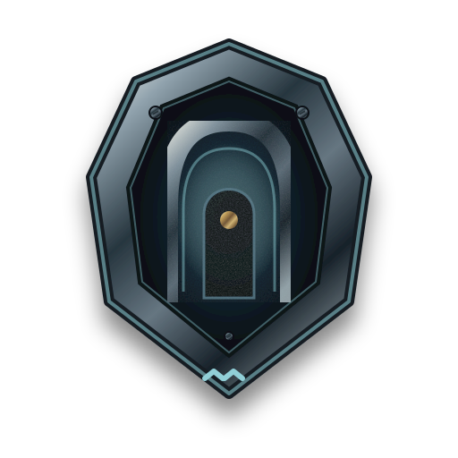 | [level-tiers-gardien-tier-2](../proposed/masters/level-tiers/gardien-tier-2.svg) | Gardien — palier 2 · **À approuver** |
| 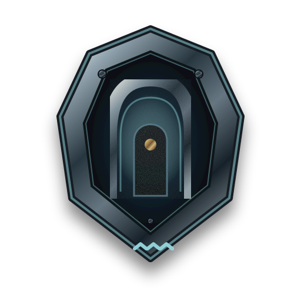 | [level-tiers-gardien-tier-3](../proposed/masters/level-tiers/gardien-tier-3.svg) | Gardien — palier 3 · **À approuver** |
| 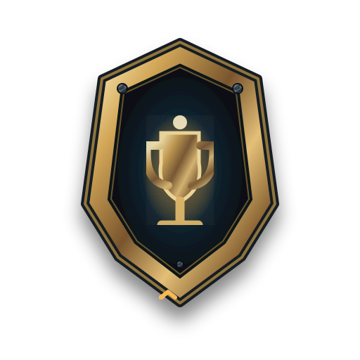 | [level-tiers-champion-tier-1](../proposed/masters/level-tiers/champion-tier-1.svg) | Champion — palier 1 · **À approuver** |
|  | [level-tiers-champion-tier-2](../proposed/masters/level-tiers/champion-tier-2.svg) | Champion — palier 2 · **À approuver** |
| 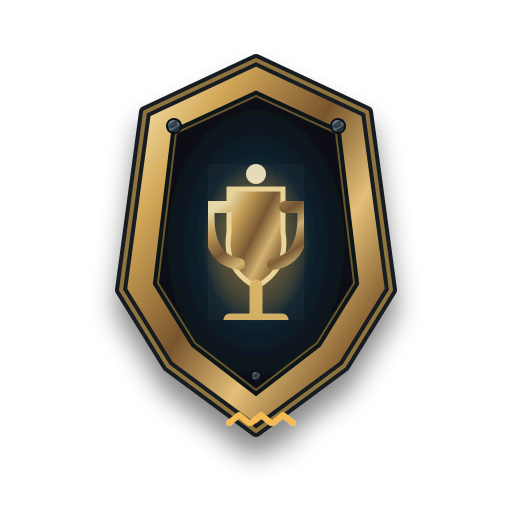 | [level-tiers-champion-tier-3](../proposed/masters/level-tiers/champion-tier-3.svg) | Champion — palier 3 · **À approuver** |
|  | [level-tiers-titan-tier-1](../proposed/masters/level-tiers/titan-tier-1.svg) | Titan — palier 1 · **À approuver** |
|  | [level-tiers-titan-tier-2](../proposed/masters/level-tiers/titan-tier-2.svg) | Titan — palier 2 · **À approuver** |
| 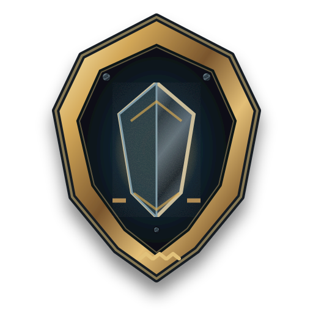 | [level-tiers-titan-tier-3](../proposed/masters/level-tiers/titan-tier-3.svg) | Titan — palier 3 · **À approuver** |
|  | [level-tiers-legende-tier-1](../proposed/masters/level-tiers/legende-tier-1.svg) | Légende — palier 1 · **À approuver** |
| 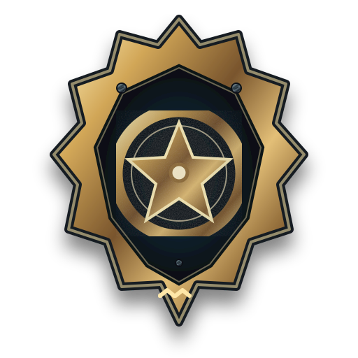 | [level-tiers-legende-tier-2](../proposed/masters/level-tiers/legende-tier-2.svg) | Légende — palier 2 · **À approuver** |
| 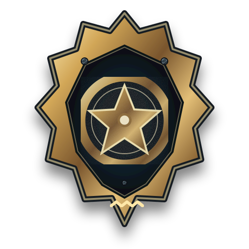 | [level-tiers-legende-tier-3](../proposed/masters/level-tiers/legende-tier-3.svg) | Légende — palier 3 · **À approuver** |

## P0 — Balises de chapitre

| Aperçu | ID | Usage / statut |
|:--:|---|---|
| 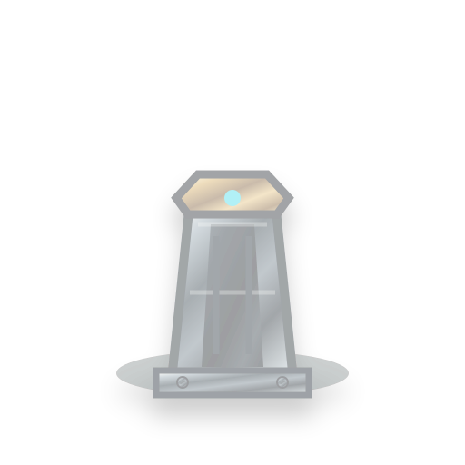 | [chapter-beacons-beacon-locked](../proposed/masters/chapter-beacons/beacon-locked.svg) | Balise locked · **À approuver** |
| 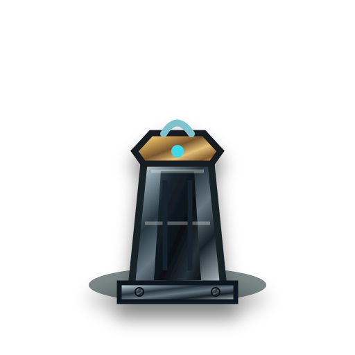 | [chapter-beacons-beacon-discovered](../proposed/masters/chapter-beacons/beacon-discovered.svg) | Balise discovered · **À approuver** |
| 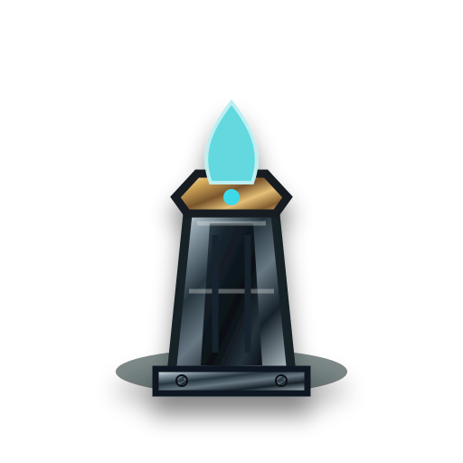 | [chapter-beacons-beacon-active](../proposed/masters/chapter-beacons/beacon-active.svg) | Balise active · **À approuver** |
|  | [chapter-beacons-beacon-confirmed](../proposed/masters/chapter-beacons/beacon-confirmed.svg) | Balise confirmed · **À approuver** |

## P0 — Récompenses

| Aperçu | ID | Usage / statut |
|:--:|---|---|
| 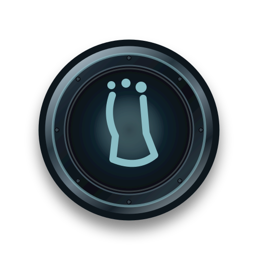 | [rewards-first-effort](../proposed/masters/rewards/first-effort.svg) | Premier effort · **À approuver** |
| 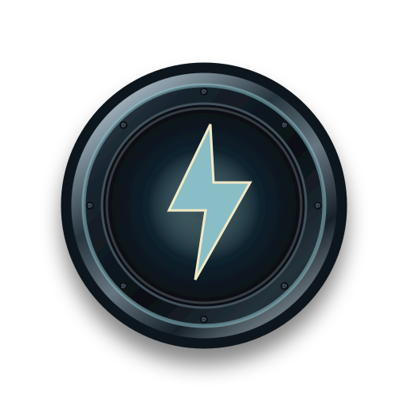 | [rewards-record](../proposed/masters/rewards/record.svg) | Record personnel · **À approuver** |
| 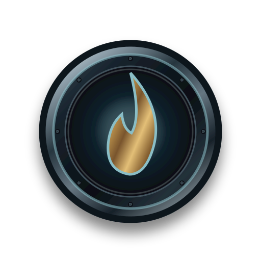 | [rewards-streak](../proposed/masters/rewards/streak.svg) | Régularité · **À approuver** |
|  | [rewards-weekly](../proposed/masters/rewards/weekly.svg) | Objectif hebdomadaire · **À approuver** |
|  | [rewards-challenge](../proposed/masters/rewards/challenge.svg) | Défi accompli · **À approuver** |
| 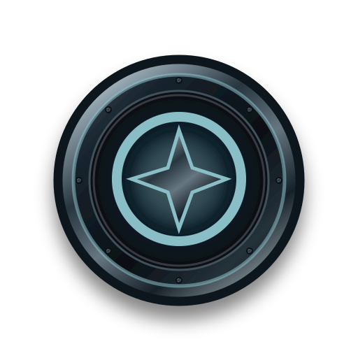 | [rewards-exploration](../proposed/masters/rewards/exploration.svg) | Découverte · **À approuver** |
| 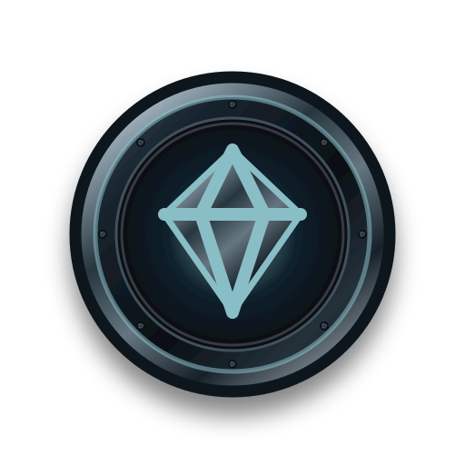 | [rewards-collection](../proposed/masters/rewards/collection.svg) | Collection · **À approuver** |
|  | [rewards-achievement](../proposed/masters/rewards/achievement.svg) | Exploit · **À approuver** |
|  | [rewards-quest](../proposed/masters/rewards/quest.svg) | Quête terminée · **À approuver** |
| 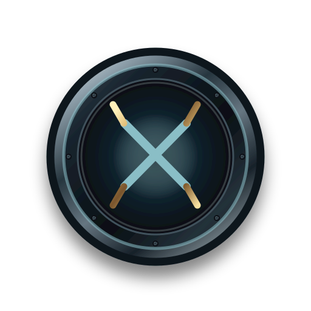 | [rewards-duel](../proposed/masters/rewards/duel.svg) | Duel · **À approuver** |
| 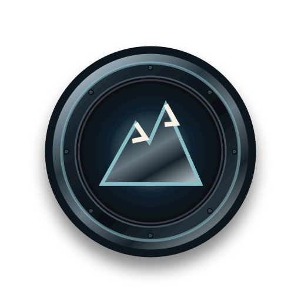 | [rewards-milestone](../proposed/masters/rewards/milestone.svg) | Jalon · **À approuver** |
|  | [rewards-rare](../proposed/masters/rewards/rare.svg) | Récompense rare · **À approuver** |

## P2 — Illustrations d'états et d'usage

| Aperçu | ID | Usage / statut |
|:--:|---|---|
|  | [ui-empty-journal](../proposed/masters/ui/empty-journal.svg) | Journal sans séance · **À approuver** |
|  | [ui-empty-records](../proposed/masters/ui/empty-records.svg) | Records à découvrir · **À approuver** |
|  | [ui-empty-stats](../proposed/masters/ui/empty-stats.svg) | Statistiques à construire · **À approuver** |
|  | [ui-empty-friends](../proposed/masters/ui/empty-friends.svg) | Amis à inviter · **À approuver** |
|  | [ui-empty-quests](../proposed/masters/ui/empty-quests.svg) | Quêtes à commencer · **À approuver** |
| 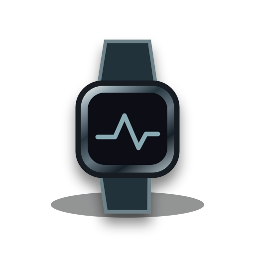 | [ui-empty-devices](../proposed/masters/ui/empty-devices.svg) | Appareil non associé · **À approuver** |
| 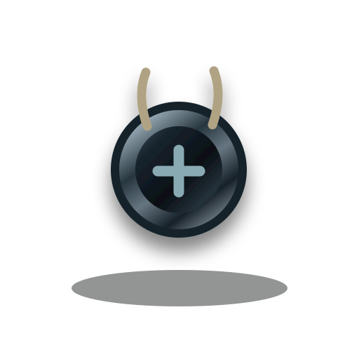 | [ui-empty-coaching](../proposed/masters/ui/empty-coaching.svg) | Coaching sans suivi · **À approuver** |
|  | [ui-empty-routes](../proposed/masters/ui/empty-routes.svg) | Parcours à tracer · **À approuver** |
| 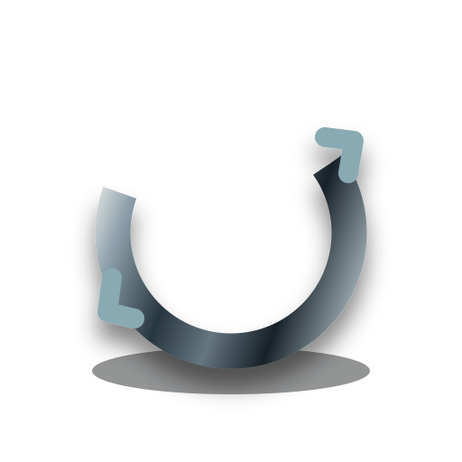 | [ui-sync](../proposed/masters/ui/sync.svg) | Synchronisation · **À approuver** |
|  | [ui-offline](../proposed/masters/ui/offline.svg) | Sans connexion · **À approuver** |
|  | [ui-import-gpx](../proposed/masters/ui/import-gpx.svg) | Import GPX · **À approuver** |
|  | [ui-completed](../proposed/masters/ui/completed.svg) | Réussite · **À approuver** |
| 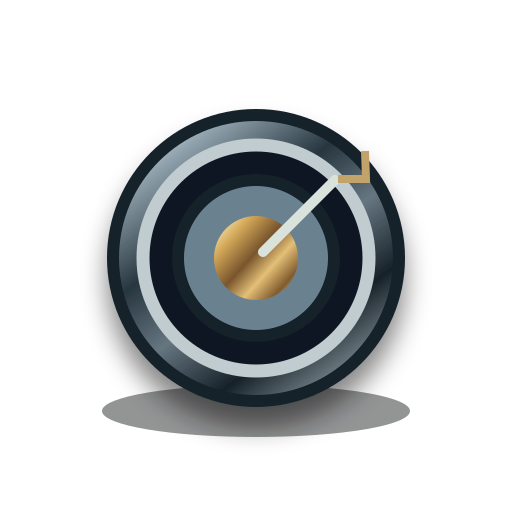 | [ui-empty-challenges](../proposed/masters/ui/empty-challenges.svg) | Défi non commencé · **À approuver** |
|  | [ui-empty-calendar](../proposed/masters/ui/empty-calendar.svg) | Planning vide · **À approuver** |

## Contrôles et limites

- Masters SVG originaux, indépendants, vectoriels, fond transparent ; les images sont des **candidats**, pas les actifs du produit.
- Le rendu visuel à 32/48/64 px, le contrôle photographique des nouveaux paysages et les exports WebP ne sont pas attestés dans ce seul commit.
- Ne pas approuver, fusionner ou déployer automatiquement.
