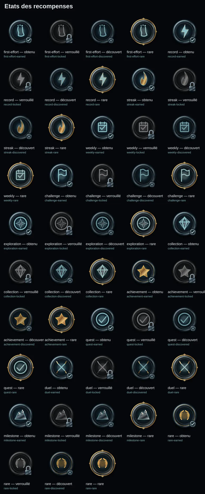
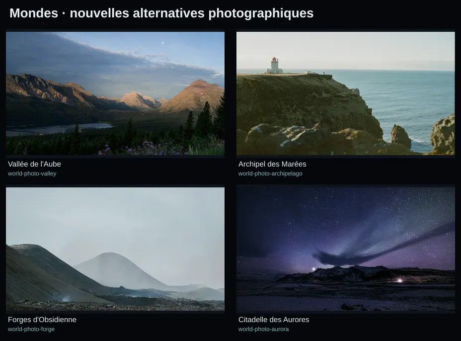
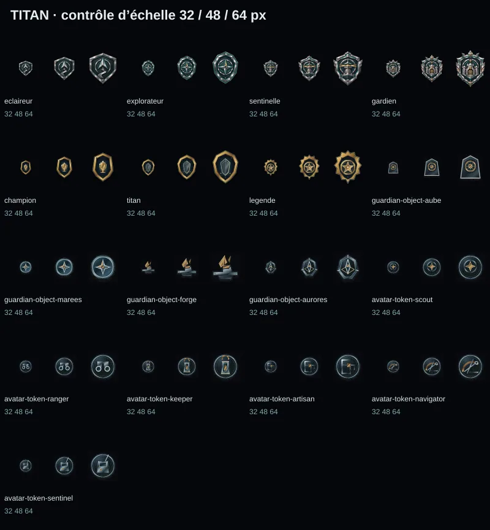

# TITAN — Galerie globale v2

**PROPOSED — approbation requise. Aucun asset integre au code ni deploye.**

Originals vectoriels: 134 | Retouches des visuels existants: 15 | PNG: 153 | WebP: 310

## Grades TITAN

- [champion](../proposed/masters/ranks/champion.svg) — Champion — **proposed** — [export](../proposed/exports/ranks/champion-512.png) [export](../proposed/exports/ranks/champion-256.webp) [export](../proposed/exports/ranks/champion-96.webp)
- [titan](../proposed/masters/ranks/titan.svg) — Titan — **proposed** — [export](../proposed/exports/ranks/titan-512.png) [export](../proposed/exports/ranks/titan-256.webp) [export](../proposed/exports/ranks/titan-96.webp)
- [legende](../proposed/masters/ranks/legende.svg) — Légende — **proposed** — [export](../proposed/exports/ranks/legende-512.png) [export](../proposed/exports/ranks/legende-256.webp) [export](../proposed/exports/ranks/legende-96.webp)

## Paliers intermediaires

- [level-tiers-eclaireur-tier-1](../proposed/masters/level-tiers/eclaireur-tier-1.svg) — Éclaireur — palier 1 — **proposed** — [export](../proposed/exports/level-tiers/eclaireur-tier-1-512.png) [export](../proposed/exports/level-tiers/eclaireur-tier-1-256.webp) [export](../proposed/exports/level-tiers/eclaireur-tier-1-96.webp)
- [level-tiers-eclaireur-tier-2](../proposed/masters/level-tiers/eclaireur-tier-2.svg) — Éclaireur — palier 2 — **proposed** — [export](../proposed/exports/level-tiers/eclaireur-tier-2-512.png) [export](../proposed/exports/level-tiers/eclaireur-tier-2-256.webp) [export](../proposed/exports/level-tiers/eclaireur-tier-2-96.webp)
- [level-tiers-eclaireur-tier-3](../proposed/masters/level-tiers/eclaireur-tier-3.svg) — Éclaireur — palier 3 — **proposed** — [export](../proposed/exports/level-tiers/eclaireur-tier-3-512.png) [export](../proposed/exports/level-tiers/eclaireur-tier-3-256.webp) [export](../proposed/exports/level-tiers/eclaireur-tier-3-96.webp)
- [level-tiers-explorateur-tier-1](../proposed/masters/level-tiers/explorateur-tier-1.svg) — Explorateur — palier 1 — **proposed** — [export](../proposed/exports/level-tiers/explorateur-tier-1-512.png) [export](../proposed/exports/level-tiers/explorateur-tier-1-256.webp) [export](../proposed/exports/level-tiers/explorateur-tier-1-96.webp)
- [level-tiers-explorateur-tier-2](../proposed/masters/level-tiers/explorateur-tier-2.svg) — Explorateur — palier 2 — **proposed** — [export](../proposed/exports/level-tiers/explorateur-tier-2-512.png) [export](../proposed/exports/level-tiers/explorateur-tier-2-256.webp) [export](../proposed/exports/level-tiers/explorateur-tier-2-96.webp)
- [level-tiers-explorateur-tier-3](../proposed/masters/level-tiers/explorateur-tier-3.svg) — Explorateur — palier 3 — **proposed** — [export](../proposed/exports/level-tiers/explorateur-tier-3-512.png) [export](../proposed/exports/level-tiers/explorateur-tier-3-256.webp) [export](../proposed/exports/level-tiers/explorateur-tier-3-96.webp)
- [level-tiers-sentinelle-tier-1](../proposed/masters/level-tiers/sentinelle-tier-1.svg) — Sentinelle — palier 1 — **proposed** — [export](../proposed/exports/level-tiers/sentinelle-tier-1-512.png) [export](../proposed/exports/level-tiers/sentinelle-tier-1-256.webp) [export](../proposed/exports/level-tiers/sentinelle-tier-1-96.webp)
- [level-tiers-sentinelle-tier-2](../proposed/masters/level-tiers/sentinelle-tier-2.svg) — Sentinelle — palier 2 — **proposed** — [export](../proposed/exports/level-tiers/sentinelle-tier-2-512.png) [export](../proposed/exports/level-tiers/sentinelle-tier-2-256.webp) [export](../proposed/exports/level-tiers/sentinelle-tier-2-96.webp)
- [level-tiers-sentinelle-tier-3](../proposed/masters/level-tiers/sentinelle-tier-3.svg) — Sentinelle — palier 3 — **proposed** — [export](../proposed/exports/level-tiers/sentinelle-tier-3-512.png) [export](../proposed/exports/level-tiers/sentinelle-tier-3-256.webp) [export](../proposed/exports/level-tiers/sentinelle-tier-3-96.webp)
- [level-tiers-gardien-tier-1](../proposed/masters/level-tiers/gardien-tier-1.svg) — Gardien — palier 1 — **proposed** — [export](../proposed/exports/level-tiers/gardien-tier-1-512.png) [export](../proposed/exports/level-tiers/gardien-tier-1-256.webp) [export](../proposed/exports/level-tiers/gardien-tier-1-96.webp)
- [level-tiers-gardien-tier-2](../proposed/masters/level-tiers/gardien-tier-2.svg) — Gardien — palier 2 — **proposed** — [export](../proposed/exports/level-tiers/gardien-tier-2-512.png) [export](../proposed/exports/level-tiers/gardien-tier-2-256.webp) [export](../proposed/exports/level-tiers/gardien-tier-2-96.webp)
- [level-tiers-gardien-tier-3](../proposed/masters/level-tiers/gardien-tier-3.svg) — Gardien — palier 3 — **proposed** — [export](../proposed/exports/level-tiers/gardien-tier-3-512.png) [export](../proposed/exports/level-tiers/gardien-tier-3-256.webp) [export](../proposed/exports/level-tiers/gardien-tier-3-96.webp)
- [level-tiers-champion-tier-1](../proposed/masters/level-tiers/champion-tier-1.svg) — Champion — palier 1 — **proposed** — [export](../proposed/exports/level-tiers/champion-tier-1-512.png) [export](../proposed/exports/level-tiers/champion-tier-1-256.webp) [export](../proposed/exports/level-tiers/champion-tier-1-96.webp)
- [level-tiers-champion-tier-2](../proposed/masters/level-tiers/champion-tier-2.svg) — Champion — palier 2 — **proposed** — [export](../proposed/exports/level-tiers/champion-tier-2-512.png) [export](../proposed/exports/level-tiers/champion-tier-2-256.webp) [export](../proposed/exports/level-tiers/champion-tier-2-96.webp)
- [level-tiers-champion-tier-3](../proposed/masters/level-tiers/champion-tier-3.svg) — Champion — palier 3 — **proposed** — [export](../proposed/exports/level-tiers/champion-tier-3-512.png) [export](../proposed/exports/level-tiers/champion-tier-3-256.webp) [export](../proposed/exports/level-tiers/champion-tier-3-96.webp)
- [level-tiers-titan-tier-1](../proposed/masters/level-tiers/titan-tier-1.svg) — Titan — palier 1 — **proposed** — [export](../proposed/exports/level-tiers/titan-tier-1-512.png) [export](../proposed/exports/level-tiers/titan-tier-1-256.webp) [export](../proposed/exports/level-tiers/titan-tier-1-96.webp)
- [level-tiers-titan-tier-2](../proposed/masters/level-tiers/titan-tier-2.svg) — Titan — palier 2 — **proposed** — [export](../proposed/exports/level-tiers/titan-tier-2-512.png) [export](../proposed/exports/level-tiers/titan-tier-2-256.webp) [export](../proposed/exports/level-tiers/titan-tier-2-96.webp)
- [level-tiers-titan-tier-3](../proposed/masters/level-tiers/titan-tier-3.svg) — Titan — palier 3 — **proposed** — [export](../proposed/exports/level-tiers/titan-tier-3-512.png) [export](../proposed/exports/level-tiers/titan-tier-3-256.webp) [export](../proposed/exports/level-tiers/titan-tier-3-96.webp)
- [level-tiers-legende-tier-1](../proposed/masters/level-tiers/legende-tier-1.svg) — Légende — palier 1 — **proposed** — [export](../proposed/exports/level-tiers/legende-tier-1-512.png) [export](../proposed/exports/level-tiers/legende-tier-1-256.webp) [export](../proposed/exports/level-tiers/legende-tier-1-96.webp)
- [level-tiers-legende-tier-2](../proposed/masters/level-tiers/legende-tier-2.svg) — Légende — palier 2 — **proposed** — [export](../proposed/exports/level-tiers/legende-tier-2-512.png) [export](../proposed/exports/level-tiers/legende-tier-2-256.webp) [export](../proposed/exports/level-tiers/legende-tier-2-96.webp)
- [level-tiers-legende-tier-3](../proposed/masters/level-tiers/legende-tier-3.svg) — Légende — palier 3 — **proposed** — [export](../proposed/exports/level-tiers/legende-tier-3-512.png) [export](../proposed/exports/level-tiers/legende-tier-3-256.webp) [export](../proposed/exports/level-tiers/legende-tier-3-96.webp)

## Balises de chapitres

- [chapter-beacons-beacon-locked](../proposed/masters/chapter-beacons/beacon-locked.svg) — Balise locked — **proposed** — [export](../proposed/exports/chapter-beacons/beacon-locked-512.png) [export](../proposed/exports/chapter-beacons/beacon-locked-256.webp) [export](../proposed/exports/chapter-beacons/beacon-locked-96.webp)
- [chapter-beacons-beacon-discovered](../proposed/masters/chapter-beacons/beacon-discovered.svg) — Balise discovered — **proposed** — [export](../proposed/exports/chapter-beacons/beacon-discovered-512.png) [export](../proposed/exports/chapter-beacons/beacon-discovered-256.webp) [export](../proposed/exports/chapter-beacons/beacon-discovered-96.webp)
- [chapter-beacons-beacon-active](../proposed/masters/chapter-beacons/beacon-active.svg) — Balise active — **proposed** — [export](../proposed/exports/chapter-beacons/beacon-active-512.png) [export](../proposed/exports/chapter-beacons/beacon-active-256.webp) [export](../proposed/exports/chapter-beacons/beacon-active-96.webp)
- [chapter-beacons-beacon-confirmed](../proposed/masters/chapter-beacons/beacon-confirmed.svg) — Balise confirmed — **proposed** — [export](../proposed/exports/chapter-beacons/beacon-confirmed-512.png) [export](../proposed/exports/chapter-beacons/beacon-confirmed-256.webp) [export](../proposed/exports/chapter-beacons/beacon-confirmed-96.webp)

## Recompenses et records

- [rewards-first-effort](../proposed/masters/rewards/first-effort.svg) — Premier effort — **proposed** — [export](../proposed/exports/rewards/first-effort-512.png) [export](../proposed/exports/rewards/first-effort-256.webp) [export](../proposed/exports/rewards/first-effort-96.webp)
- [rewards-record](../proposed/masters/rewards/record.svg) — Record personnel — **proposed** — [export](../proposed/exports/rewards/record-512.png) [export](../proposed/exports/rewards/record-256.webp) [export](../proposed/exports/rewards/record-96.webp)
- [rewards-streak](../proposed/masters/rewards/streak.svg) — Régularité — **proposed** — [export](../proposed/exports/rewards/streak-512.png) [export](../proposed/exports/rewards/streak-256.webp) [export](../proposed/exports/rewards/streak-96.webp)
- [rewards-weekly](../proposed/masters/rewards/weekly.svg) — Objectif hebdomadaire — **proposed** — [export](../proposed/exports/rewards/weekly-512.png) [export](../proposed/exports/rewards/weekly-256.webp) [export](../proposed/exports/rewards/weekly-96.webp)
- [rewards-challenge](../proposed/masters/rewards/challenge.svg) — Défi accompli — **proposed** — [export](../proposed/exports/rewards/challenge-512.png) [export](../proposed/exports/rewards/challenge-256.webp) [export](../proposed/exports/rewards/challenge-96.webp)
- [rewards-exploration](../proposed/masters/rewards/exploration.svg) — Découverte — **proposed** — [export](../proposed/exports/rewards/exploration-512.png) [export](../proposed/exports/rewards/exploration-256.webp) [export](../proposed/exports/rewards/exploration-96.webp)
- [rewards-collection](../proposed/masters/rewards/collection.svg) — Collection — **proposed** — [export](../proposed/exports/rewards/collection-512.png) [export](../proposed/exports/rewards/collection-256.webp) [export](../proposed/exports/rewards/collection-96.webp)
- [rewards-achievement](../proposed/masters/rewards/achievement.svg) — Exploit — **proposed** — [export](../proposed/exports/rewards/achievement-512.png) [export](../proposed/exports/rewards/achievement-256.webp) [export](../proposed/exports/rewards/achievement-96.webp)
- [rewards-quest](../proposed/masters/rewards/quest.svg) — Quête terminée — **proposed** — [export](../proposed/exports/rewards/quest-512.png) [export](../proposed/exports/rewards/quest-256.webp) [export](../proposed/exports/rewards/quest-96.webp)
- [rewards-duel](../proposed/masters/rewards/duel.svg) — Duel — **proposed** — [export](../proposed/exports/rewards/duel-512.png) [export](../proposed/exports/rewards/duel-256.webp) [export](../proposed/exports/rewards/duel-96.webp)
- [rewards-milestone](../proposed/masters/rewards/milestone.svg) — Jalon — **proposed** — [export](../proposed/exports/rewards/milestone-512.png) [export](../proposed/exports/rewards/milestone-256.webp) [export](../proposed/exports/rewards/milestone-96.webp)
- [rewards-rare](../proposed/masters/rewards/rare.svg) — Récompense rare — **proposed** — [export](../proposed/exports/rewards/rare-512.png) [export](../proposed/exports/rewards/rare-256.webp) [export](../proposed/exports/rewards/rare-96.webp)

## Etats des recompenses

- [first-effort-earned](../proposed/masters/reward-states/first-effort-earned.svg) — first-effort — obtenu — **proposed** — [export](../proposed/exports/reward-states/first-effort-earned-512.png) [export](../proposed/exports/reward-states/first-effort-earned-256.webp) [export](../proposed/exports/reward-states/first-effort-earned-96.webp)
- [first-effort-locked](../proposed/masters/reward-states/first-effort-locked.svg) — first-effort — verrouillé — **proposed** — [export](../proposed/exports/reward-states/first-effort-locked-512.png) [export](../proposed/exports/reward-states/first-effort-locked-256.webp) [export](../proposed/exports/reward-states/first-effort-locked-96.webp)
- [first-effort-discovered](../proposed/masters/reward-states/first-effort-discovered.svg) — first-effort — découvert — **proposed** — [export](../proposed/exports/reward-states/first-effort-discovered-512.png) [export](../proposed/exports/reward-states/first-effort-discovered-256.webp) [export](../proposed/exports/reward-states/first-effort-discovered-96.webp)
- [first-effort-rare](../proposed/masters/reward-states/first-effort-rare.svg) — first-effort — rare — **proposed** — [export](../proposed/exports/reward-states/first-effort-rare-512.png) [export](../proposed/exports/reward-states/first-effort-rare-256.webp) [export](../proposed/exports/reward-states/first-effort-rare-96.webp)
- [record-earned](../proposed/masters/reward-states/record-earned.svg) — record — obtenu — **proposed** — [export](../proposed/exports/reward-states/record-earned-512.png) [export](../proposed/exports/reward-states/record-earned-256.webp) [export](../proposed/exports/reward-states/record-earned-96.webp)
- [record-locked](../proposed/masters/reward-states/record-locked.svg) — record — verrouillé — **proposed** — [export](../proposed/exports/reward-states/record-locked-512.png) [export](../proposed/exports/reward-states/record-locked-256.webp) [export](../proposed/exports/reward-states/record-locked-96.webp)
- [record-discovered](../proposed/masters/reward-states/record-discovered.svg) — record — découvert — **proposed** — [export](../proposed/exports/reward-states/record-discovered-512.png) [export](../proposed/exports/reward-states/record-discovered-256.webp) [export](../proposed/exports/reward-states/record-discovered-96.webp)
- [record-rare](../proposed/masters/reward-states/record-rare.svg) — record — rare — **proposed** — [export](../proposed/exports/reward-states/record-rare-512.png) [export](../proposed/exports/reward-states/record-rare-256.webp) [export](../proposed/exports/reward-states/record-rare-96.webp)
- [streak-earned](../proposed/masters/reward-states/streak-earned.svg) — streak — obtenu — **proposed** — [export](../proposed/exports/reward-states/streak-earned-512.png) [export](../proposed/exports/reward-states/streak-earned-256.webp) [export](../proposed/exports/reward-states/streak-earned-96.webp)
- [streak-locked](../proposed/masters/reward-states/streak-locked.svg) — streak — verrouillé — **proposed** — [export](../proposed/exports/reward-states/streak-locked-512.png) [export](../proposed/exports/reward-states/streak-locked-256.webp) [export](../proposed/exports/reward-states/streak-locked-96.webp)
- [streak-discovered](../proposed/masters/reward-states/streak-discovered.svg) — streak — découvert — **proposed** — [export](../proposed/exports/reward-states/streak-discovered-512.png) [export](../proposed/exports/reward-states/streak-discovered-256.webp) [export](../proposed/exports/reward-states/streak-discovered-96.webp)
- [streak-rare](../proposed/masters/reward-states/streak-rare.svg) — streak — rare — **proposed** — [export](../proposed/exports/reward-states/streak-rare-512.png) [export](../proposed/exports/reward-states/streak-rare-256.webp) [export](../proposed/exports/reward-states/streak-rare-96.webp)
- [weekly-earned](../proposed/masters/reward-states/weekly-earned.svg) — weekly — obtenu — **proposed** — [export](../proposed/exports/reward-states/weekly-earned-512.png) [export](../proposed/exports/reward-states/weekly-earned-256.webp) [export](../proposed/exports/reward-states/weekly-earned-96.webp)
- [weekly-locked](../proposed/masters/reward-states/weekly-locked.svg) — weekly — verrouillé — **proposed** — [export](../proposed/exports/reward-states/weekly-locked-512.png) [export](../proposed/exports/reward-states/weekly-locked-256.webp) [export](../proposed/exports/reward-states/weekly-locked-96.webp)
- [weekly-discovered](../proposed/masters/reward-states/weekly-discovered.svg) — weekly — découvert — **proposed** — [export](../proposed/exports/reward-states/weekly-discovered-512.png) [export](../proposed/exports/reward-states/weekly-discovered-256.webp) [export](../proposed/exports/reward-states/weekly-discovered-96.webp)
- [weekly-rare](../proposed/masters/reward-states/weekly-rare.svg) — weekly — rare — **proposed** — [export](../proposed/exports/reward-states/weekly-rare-512.png) [export](../proposed/exports/reward-states/weekly-rare-256.webp) [export](../proposed/exports/reward-states/weekly-rare-96.webp)
- [challenge-earned](../proposed/masters/reward-states/challenge-earned.svg) — challenge — obtenu — **proposed** — [export](../proposed/exports/reward-states/challenge-earned-512.png) [export](../proposed/exports/reward-states/challenge-earned-256.webp) [export](../proposed/exports/reward-states/challenge-earned-96.webp)
- [challenge-locked](../proposed/masters/reward-states/challenge-locked.svg) — challenge — verrouillé — **proposed** — [export](../proposed/exports/reward-states/challenge-locked-512.png) [export](../proposed/exports/reward-states/challenge-locked-256.webp) [export](../proposed/exports/reward-states/challenge-locked-96.webp)
- [challenge-discovered](../proposed/masters/reward-states/challenge-discovered.svg) — challenge — découvert — **proposed** — [export](../proposed/exports/reward-states/challenge-discovered-512.png) [export](../proposed/exports/reward-states/challenge-discovered-256.webp) [export](../proposed/exports/reward-states/challenge-discovered-96.webp)
- [challenge-rare](../proposed/masters/reward-states/challenge-rare.svg) — challenge — rare — **proposed** — [export](../proposed/exports/reward-states/challenge-rare-512.png) [export](../proposed/exports/reward-states/challenge-rare-256.webp) [export](../proposed/exports/reward-states/challenge-rare-96.webp)
- [exploration-earned](../proposed/masters/reward-states/exploration-earned.svg) — exploration — obtenu — **proposed** — [export](../proposed/exports/reward-states/exploration-earned-512.png) [export](../proposed/exports/reward-states/exploration-earned-256.webp) [export](../proposed/exports/reward-states/exploration-earned-96.webp)
- [exploration-locked](../proposed/masters/reward-states/exploration-locked.svg) — exploration — verrouillé — **proposed** — [export](../proposed/exports/reward-states/exploration-locked-512.png) [export](../proposed/exports/reward-states/exploration-locked-256.webp) [export](../proposed/exports/reward-states/exploration-locked-96.webp)
- [exploration-discovered](../proposed/masters/reward-states/exploration-discovered.svg) — exploration — découvert — **proposed** — [export](../proposed/exports/reward-states/exploration-discovered-512.png) [export](../proposed/exports/reward-states/exploration-discovered-256.webp) [export](../proposed/exports/reward-states/exploration-discovered-96.webp)
- [exploration-rare](../proposed/masters/reward-states/exploration-rare.svg) — exploration — rare — **proposed** — [export](../proposed/exports/reward-states/exploration-rare-512.png) [export](../proposed/exports/reward-states/exploration-rare-256.webp) [export](../proposed/exports/reward-states/exploration-rare-96.webp)
- [collection-earned](../proposed/masters/reward-states/collection-earned.svg) — collection — obtenu — **proposed** — [export](../proposed/exports/reward-states/collection-earned-512.png) [export](../proposed/exports/reward-states/collection-earned-256.webp) [export](../proposed/exports/reward-states/collection-earned-96.webp)
- [collection-locked](../proposed/masters/reward-states/collection-locked.svg) — collection — verrouillé — **proposed** — [export](../proposed/exports/reward-states/collection-locked-512.png) [export](../proposed/exports/reward-states/collection-locked-256.webp) [export](../proposed/exports/reward-states/collection-locked-96.webp)
- [collection-discovered](../proposed/masters/reward-states/collection-discovered.svg) — collection — découvert — **proposed** — [export](../proposed/exports/reward-states/collection-discovered-512.png) [export](../proposed/exports/reward-states/collection-discovered-256.webp) [export](../proposed/exports/reward-states/collection-discovered-96.webp)
- [collection-rare](../proposed/masters/reward-states/collection-rare.svg) — collection — rare — **proposed** — [export](../proposed/exports/reward-states/collection-rare-512.png) [export](../proposed/exports/reward-states/collection-rare-256.webp) [export](../proposed/exports/reward-states/collection-rare-96.webp)
- [achievement-earned](../proposed/masters/reward-states/achievement-earned.svg) — achievement — obtenu — **proposed** — [export](../proposed/exports/reward-states/achievement-earned-512.png) [export](../proposed/exports/reward-states/achievement-earned-256.webp) [export](../proposed/exports/reward-states/achievement-earned-96.webp)
- [achievement-locked](../proposed/masters/reward-states/achievement-locked.svg) — achievement — verrouillé — **proposed** — [export](../proposed/exports/reward-states/achievement-locked-512.png) [export](../proposed/exports/reward-states/achievement-locked-256.webp) [export](../proposed/exports/reward-states/achievement-locked-96.webp)
- [achievement-discovered](../proposed/masters/reward-states/achievement-discovered.svg) — achievement — découvert — **proposed** — [export](../proposed/exports/reward-states/achievement-discovered-512.png) [export](../proposed/exports/reward-states/achievement-discovered-256.webp) [export](../proposed/exports/reward-states/achievement-discovered-96.webp)
- [achievement-rare](../proposed/masters/reward-states/achievement-rare.svg) — achievement — rare — **proposed** — [export](../proposed/exports/reward-states/achievement-rare-512.png) [export](../proposed/exports/reward-states/achievement-rare-256.webp) [export](../proposed/exports/reward-states/achievement-rare-96.webp)
- [quest-earned](../proposed/masters/reward-states/quest-earned.svg) — quest — obtenu — **proposed** — [export](../proposed/exports/reward-states/quest-earned-512.png) [export](../proposed/exports/reward-states/quest-earned-256.webp) [export](../proposed/exports/reward-states/quest-earned-96.webp)
- [quest-locked](../proposed/masters/reward-states/quest-locked.svg) — quest — verrouillé — **proposed** — [export](../proposed/exports/reward-states/quest-locked-512.png) [export](../proposed/exports/reward-states/quest-locked-256.webp) [export](../proposed/exports/reward-states/quest-locked-96.webp)
- [quest-discovered](../proposed/masters/reward-states/quest-discovered.svg) — quest — découvert — **proposed** — [export](../proposed/exports/reward-states/quest-discovered-512.png) [export](../proposed/exports/reward-states/quest-discovered-256.webp) [export](../proposed/exports/reward-states/quest-discovered-96.webp)
- [quest-rare](../proposed/masters/reward-states/quest-rare.svg) — quest — rare — **proposed** — [export](../proposed/exports/reward-states/quest-rare-512.png) [export](../proposed/exports/reward-states/quest-rare-256.webp) [export](../proposed/exports/reward-states/quest-rare-96.webp)
- [duel-earned](../proposed/masters/reward-states/duel-earned.svg) — duel — obtenu — **proposed** — [export](../proposed/exports/reward-states/duel-earned-512.png) [export](../proposed/exports/reward-states/duel-earned-256.webp) [export](../proposed/exports/reward-states/duel-earned-96.webp)
- [duel-locked](../proposed/masters/reward-states/duel-locked.svg) — duel — verrouillé — **proposed** — [export](../proposed/exports/reward-states/duel-locked-512.png) [export](../proposed/exports/reward-states/duel-locked-256.webp) [export](../proposed/exports/reward-states/duel-locked-96.webp)
- [duel-discovered](../proposed/masters/reward-states/duel-discovered.svg) — duel — découvert — **proposed** — [export](../proposed/exports/reward-states/duel-discovered-512.png) [export](../proposed/exports/reward-states/duel-discovered-256.webp) [export](../proposed/exports/reward-states/duel-discovered-96.webp)
- [duel-rare](../proposed/masters/reward-states/duel-rare.svg) — duel — rare — **proposed** — [export](../proposed/exports/reward-states/duel-rare-512.png) [export](../proposed/exports/reward-states/duel-rare-256.webp) [export](../proposed/exports/reward-states/duel-rare-96.webp)
- [milestone-earned](../proposed/masters/reward-states/milestone-earned.svg) — milestone — obtenu — **proposed** — [export](../proposed/exports/reward-states/milestone-earned-512.png) [export](../proposed/exports/reward-states/milestone-earned-256.webp) [export](../proposed/exports/reward-states/milestone-earned-96.webp)
- [milestone-locked](../proposed/masters/reward-states/milestone-locked.svg) — milestone — verrouillé — **proposed** — [export](../proposed/exports/reward-states/milestone-locked-512.png) [export](../proposed/exports/reward-states/milestone-locked-256.webp) [export](../proposed/exports/reward-states/milestone-locked-96.webp)
- [milestone-discovered](../proposed/masters/reward-states/milestone-discovered.svg) — milestone — découvert — **proposed** — [export](../proposed/exports/reward-states/milestone-discovered-512.png) [export](../proposed/exports/reward-states/milestone-discovered-256.webp) [export](../proposed/exports/reward-states/milestone-discovered-96.webp)
- [milestone-rare](../proposed/masters/reward-states/milestone-rare.svg) — milestone — rare — **proposed** — [export](../proposed/exports/reward-states/milestone-rare-512.png) [export](../proposed/exports/reward-states/milestone-rare-256.webp) [export](../proposed/exports/reward-states/milestone-rare-96.webp)
- [rare-earned](../proposed/masters/reward-states/rare-earned.svg) — rare — obtenu — **proposed** — [export](../proposed/exports/reward-states/rare-earned-512.png) [export](../proposed/exports/reward-states/rare-earned-256.webp) [export](../proposed/exports/reward-states/rare-earned-96.webp)
- [rare-locked](../proposed/masters/reward-states/rare-locked.svg) — rare — verrouillé — **proposed** — [export](../proposed/exports/reward-states/rare-locked-512.png) [export](../proposed/exports/reward-states/rare-locked-256.webp) [export](../proposed/exports/reward-states/rare-locked-96.webp)
- [rare-discovered](../proposed/masters/reward-states/rare-discovered.svg) — rare — découvert — **proposed** — [export](../proposed/exports/reward-states/rare-discovered-512.png) [export](../proposed/exports/reward-states/rare-discovered-256.webp) [export](../proposed/exports/reward-states/rare-discovered-96.webp)
- [rare-rare](../proposed/masters/reward-states/rare-rare.svg) — rare — rare — **proposed** — [export](../proposed/exports/reward-states/rare-rare-512.png) [export](../proposed/exports/reward-states/rare-rare-256.webp) [export](../proposed/exports/reward-states/rare-rare-96.webp)

## Etats et modules

- [ui-empty-journal](../proposed/masters/ui/empty-journal.svg) — Journal sans séance — **proposed** — [export](../proposed/exports/ui/empty-journal-512.png) [export](../proposed/exports/ui/empty-journal-256.webp) [export](../proposed/exports/ui/empty-journal-96.webp)
- [ui-empty-records](../proposed/masters/ui/empty-records.svg) — Records à découvrir — **proposed** — [export](../proposed/exports/ui/empty-records-512.png) [export](../proposed/exports/ui/empty-records-256.webp) [export](../proposed/exports/ui/empty-records-96.webp)
- [ui-empty-stats](../proposed/masters/ui/empty-stats.svg) — Statistiques à construire — **proposed** — [export](../proposed/exports/ui/empty-stats-512.png) [export](../proposed/exports/ui/empty-stats-256.webp) [export](../proposed/exports/ui/empty-stats-96.webp)
- [ui-empty-friends](../proposed/masters/ui/empty-friends.svg) — Amis à inviter — **proposed** — [export](../proposed/exports/ui/empty-friends-512.png) [export](../proposed/exports/ui/empty-friends-256.webp) [export](../proposed/exports/ui/empty-friends-96.webp)
- [ui-empty-quests](../proposed/masters/ui/empty-quests.svg) — Quêtes à commencer — **proposed** — [export](../proposed/exports/ui/empty-quests-512.png) [export](../proposed/exports/ui/empty-quests-256.webp) [export](../proposed/exports/ui/empty-quests-96.webp)
- [ui-empty-devices](../proposed/masters/ui/empty-devices.svg) — Appareil non associé — **proposed** — [export](../proposed/exports/ui/empty-devices-512.png) [export](../proposed/exports/ui/empty-devices-256.webp) [export](../proposed/exports/ui/empty-devices-96.webp)
- [ui-empty-coaching](../proposed/masters/ui/empty-coaching.svg) — Coaching sans suivi — **proposed** — [export](../proposed/exports/ui/empty-coaching-512.png) [export](../proposed/exports/ui/empty-coaching-256.webp) [export](../proposed/exports/ui/empty-coaching-96.webp)
- [ui-empty-routes](../proposed/masters/ui/empty-routes.svg) — Parcours à tracer — **proposed** — [export](../proposed/exports/ui/empty-routes-512.png) [export](../proposed/exports/ui/empty-routes-256.webp) [export](../proposed/exports/ui/empty-routes-96.webp)
- [ui-sync](../proposed/masters/ui/sync.svg) — Synchronisation — **proposed** — [export](../proposed/exports/ui/sync-512.png) [export](../proposed/exports/ui/sync-256.webp) [export](../proposed/exports/ui/sync-96.webp)
- [ui-offline](../proposed/masters/ui/offline.svg) — Sans connexion — **proposed** — [export](../proposed/exports/ui/offline-512.png) [export](../proposed/exports/ui/offline-256.webp) [export](../proposed/exports/ui/offline-96.webp)
- [ui-import-gpx](../proposed/masters/ui/import-gpx.svg) — Import GPX — **proposed** — [export](../proposed/exports/ui/import-gpx-512.png) [export](../proposed/exports/ui/import-gpx-256.webp) [export](../proposed/exports/ui/import-gpx-96.webp)
- [ui-completed](../proposed/masters/ui/completed.svg) — Réussite — **proposed** — [export](../proposed/exports/ui/completed-512.png) [export](../proposed/exports/ui/completed-256.webp) [export](../proposed/exports/ui/completed-96.webp)
- [ui-empty-challenges](../proposed/masters/ui/empty-challenges.svg) — Défi non commencé — **proposed** — [export](../proposed/exports/ui/empty-challenges-512.png) [export](../proposed/exports/ui/empty-challenges-256.webp) [export](../proposed/exports/ui/empty-challenges-96.webp)
- [ui-empty-calendar](../proposed/masters/ui/empty-calendar.svg) — Planning vide — **proposed** — [export](../proposed/exports/ui/empty-calendar-512.png) [export](../proposed/exports/ui/empty-calendar-256.webp) [export](../proposed/exports/ui/empty-calendar-96.webp)
- [empty-moments](../proposed/masters/ui/empty-moments.svg) — Moments · aucun partage — **proposed** — [export](../proposed/exports/ui/empty-moments-512.png) [export](../proposed/exports/ui/empty-moments-256.webp) [export](../proposed/exports/ui/empty-moments-96.webp)
- [empty-guild](../proposed/masters/ui/empty-guild.svg) — Guilde · première équipe — **proposed** — [export](../proposed/exports/ui/empty-guild-512.png) [export](../proposed/exports/ui/empty-guild-256.webp) [export](../proposed/exports/ui/empty-guild-96.webp)
- [empty-binom](../proposed/masters/ui/empty-binom.svg) — Binôme · duo à créer — **proposed** — [export](../proposed/exports/ui/empty-binom-512.png) [export](../proposed/exports/ui/empty-binom-256.webp) [export](../proposed/exports/ui/empty-binom-96.webp)
- [empty-ranking](../proposed/masters/ui/empty-ranking.svg) — Classement · aucune participation — **proposed** — [export](../proposed/exports/ui/empty-ranking-512.png) [export](../proposed/exports/ui/empty-ranking-256.webp) [export](../proposed/exports/ui/empty-ranking-96.webp)
- [empty-weekly-quests](../proposed/masters/ui/empty-weekly-quests.svg) — Quêtes hebdomadaires — **proposed** — [export](../proposed/exports/ui/empty-weekly-quests-512.png) [export](../proposed/exports/ui/empty-weekly-quests-256.webp) [export](../proposed/exports/ui/empty-weekly-quests-96.webp)
- [empty-season](../proposed/masters/ui/empty-season.svg) — Saison · première participation — **proposed** — [export](../proposed/exports/ui/empty-season-512.png) [export](../proposed/exports/ui/empty-season-256.webp) [export](../proposed/exports/ui/empty-season-96.webp)
- [profile-passport](../proposed/masters/ui/profile-passport.svg) — Profil · passeport sportif — **proposed** — [export](../proposed/exports/ui/profile-passport-512.png) [export](../proposed/exports/ui/profile-passport-256.webp) [export](../proposed/exports/ui/profile-passport-96.webp)
- [sport-dna](../proposed/masters/ui/sport-dna.svg) — ADN sportif · exploration des pratiques — **proposed** — [export](../proposed/exports/ui/sport-dna-512.png) [export](../proposed/exports/ui/sport-dna-256.webp) [export](../proposed/exports/ui/sport-dna-96.webp)
- [empty-atelier](../proposed/masters/ui/empty-atelier.svg) — Atelier · collection à constituer — **proposed** — [export](../proposed/exports/ui/empty-atelier-512.png) [export](../proposed/exports/ui/empty-atelier-256.webp) [export](../proposed/exports/ui/empty-atelier-96.webp)
- [empty-notifications](../proposed/masters/ui/empty-notifications.svg) — Notifications · aucune alerte — **proposed** — [export](../proposed/exports/ui/empty-notifications-512.png) [export](../proposed/exports/ui/empty-notifications-256.webp) [export](../proposed/exports/ui/empty-notifications-96.webp)
- [report-summary](../proposed/masters/ui/report-summary.svg) — Rapports · récapitulatif — **proposed** — [export](../proposed/exports/ui/report-summary-512.png) [export](../proposed/exports/ui/report-summary-256.webp) [export](../proposed/exports/ui/report-summary-96.webp)
- [record-detail](../proposed/masters/ui/record-detail.svg) — Record · séance source — **proposed** — [export](../proposed/exports/ui/record-detail-512.png) [export](../proposed/exports/ui/record-detail-256.webp) [export](../proposed/exports/ui/record-detail-96.webp)
- [gps-tracking](../proposed/masters/ui/gps-tracking.svg) — GPS · enregistrement actif — **proposed** — [export](../proposed/exports/ui/gps-tracking-512.png) [export](../proposed/exports/ui/gps-tracking-256.webp) [export](../proposed/exports/ui/gps-tracking-96.webp)
- [gps-location-missing](../proposed/masters/ui/gps-location-missing.svg) — GPS · position indisponible — **proposed** — [export](../proposed/exports/ui/gps-location-missing-512.png) [export](../proposed/exports/ui/gps-location-missing-256.webp) [export](../proposed/exports/ui/gps-location-missing-96.webp)
- [import-error](../proposed/masters/ui/import-error.svg) — Import GPX · fichier invalide — **proposed** — [export](../proposed/exports/ui/import-error-512.png) [export](../proposed/exports/ui/import-error-256.webp) [export](../proposed/exports/ui/import-error-96.webp)
- [empty-route-library](../proposed/masters/ui/empty-route-library.svg) — Parcours · carnet d’itinéraires — **proposed** — [export](../proposed/exports/ui/empty-route-library-512.png) [export](../proposed/exports/ui/empty-route-library-256.webp) [export](../proposed/exports/ui/empty-route-library-96.webp)
- [empty-coach-clients](../proposed/masters/ui/empty-coach-clients.svg) — Coaching · athlètes absents — **proposed** — [export](../proposed/exports/ui/empty-coach-clients-512.png) [export](../proposed/exports/ui/empty-coach-clients-256.webp) [export](../proposed/exports/ui/empty-coach-clients-96.webp)
- [empty-program](../proposed/masters/ui/empty-program.svg) — Programme · séance à construire — **proposed** — [export](../proposed/exports/ui/empty-program-512.png) [export](../proposed/exports/ui/empty-program-256.webp) [export](../proposed/exports/ui/empty-program-96.webp)
- [empty-workout](../proposed/masters/ui/empty-workout.svg) — Séance · premier entraînement — **proposed** — [export](../proposed/exports/ui/empty-workout-512.png) [export](../proposed/exports/ui/empty-workout-256.webp) [export](../proposed/exports/ui/empty-workout-96.webp)
- [empty-discovery](../proposed/masters/ui/empty-discovery.svg) — Découverte · sports à essayer — **proposed** — [export](../proposed/exports/ui/empty-discovery-512.png) [export](../proposed/exports/ui/empty-discovery-256.webp) [export](../proposed/exports/ui/empty-discovery-96.webp)
- [success-upload](../proposed/masters/ui/success-upload.svg) — Import réussi · activité reçue — **proposed** — [export](../proposed/exports/ui/success-upload-512.png) [export](../proposed/exports/ui/success-upload-256.webp) [export](../proposed/exports/ui/success-upload-96.webp)
- [error-system](../proposed/masters/ui/error-system.svg) — Erreur système · action à reprendre — **proposed** — [export](../proposed/exports/ui/error-system-512.png) [export](../proposed/exports/ui/error-system-256.webp) [export](../proposed/exports/ui/error-system-96.webp)

## Mondes Renaissance · remasters

- [valley](../proposed/masters/renaissance/valley.png) — valley — **proposed** — [export](../proposed/exports/renaissance/valley-web.webp) [export](../proposed/exports/renaissance/valley-android.webp)
- [archipelago](../proposed/masters/renaissance/archipelago.png) — archipelago — **proposed** — [export](../proposed/exports/renaissance/archipelago-web.webp) [export](../proposed/exports/renaissance/archipelago-android.webp)
- [forge](../proposed/masters/renaissance/forge.png) — forge — **proposed** — [export](../proposed/exports/renaissance/forge-web.webp) [export](../proposed/exports/renaissance/forge-android.webp)
- [aurora](../proposed/masters/renaissance/aurora.png) — aurora — **proposed** — [export](../proposed/exports/renaissance/aurora-web.webp) [export](../proposed/exports/renaissance/aurora-android.webp)

## Mondes · nouvelles alternatives photographiques

- [world-photo-valley](../proposed/masters/photographic-worlds/valley.png) — Vallée de l'Aube — **proposed** — [export](../proposed/exports/photographic-worlds/valley-web.webp) [export](../proposed/exports/photographic-worlds/valley-android.webp) [export](../proposed/exports/photographic-worlds/valley-thumb.webp)
- [world-photo-archipelago](../proposed/masters/photographic-worlds/archipelago.png) — Archipel des Marées — **proposed** — [export](../proposed/exports/photographic-worlds/archipelago-web.webp) [export](../proposed/exports/photographic-worlds/archipelago-android.webp) [export](../proposed/exports/photographic-worlds/archipelago-thumb.webp)
- [world-photo-forge](../proposed/masters/photographic-worlds/forge.png) — Forges d'Obsidienne — **proposed** — [export](../proposed/exports/photographic-worlds/forge-web.webp) [export](../proposed/exports/photographic-worlds/forge-android.webp) [export](../proposed/exports/photographic-worlds/forge-thumb.webp)
- [world-photo-aurora](../proposed/masters/photographic-worlds/aurora.png) — Citadelle des Aurores — **proposed** — [export](../proposed/exports/photographic-worlds/aurora-web.webp) [export](../proposed/exports/photographic-worlds/aurora-android.webp) [export](../proposed/exports/photographic-worlds/aurora-thumb.webp)

## Gardiens et avatars · remasters

- [guardian-aube](../proposed/masters/renaissance/guardian-aube.png) — guardian-aube — **proposed** — [export](../proposed/exports/renaissance/guardian-aube-web.webp) [export](../proposed/exports/renaissance/guardian-aube-android.webp)
- [guardian-marees](../proposed/masters/renaissance/guardian-marees.png) — guardian-marees — **proposed** — [export](../proposed/exports/renaissance/guardian-marees-web.webp) [export](../proposed/exports/renaissance/guardian-marees-android.webp)
- [guardian-forge](../proposed/masters/renaissance/guardian-forge.png) — guardian-forge — **proposed** — [export](../proposed/exports/renaissance/guardian-forge-web.webp) [export](../proposed/exports/renaissance/guardian-forge-android.webp)
- [guardian-aurores](../proposed/masters/renaissance/guardian-aurores.png) — guardian-aurores — **proposed** — [export](../proposed/exports/renaissance/guardian-aurores-web.webp) [export](../proposed/exports/renaissance/guardian-aurores-android.webp)
- [scout](../proposed/masters/renaissance/scout.png) — scout — **proposed** — [export](../proposed/exports/renaissance/scout-web.webp) [export](../proposed/exports/renaissance/scout-android.webp)
- [ranger](../proposed/masters/renaissance/ranger.png) — ranger — **proposed** — [export](../proposed/exports/renaissance/ranger-web.webp) [export](../proposed/exports/renaissance/ranger-android.webp)
- [keeper](../proposed/masters/renaissance/keeper.png) — keeper — **proposed** — [export](../proposed/exports/renaissance/keeper-web.webp) [export](../proposed/exports/renaissance/keeper-android.webp)
- [artisan](../proposed/masters/renaissance/artisan.png) — artisan — **proposed** — [export](../proposed/exports/renaissance/artisan-web.webp) [export](../proposed/exports/renaissance/artisan-android.webp)
- [navigator](../proposed/masters/renaissance/navigator.png) — navigator — **proposed** — [export](../proposed/exports/renaissance/navigator-web.webp) [export](../proposed/exports/renaissance/navigator-android.webp)
- [sentinel](../proposed/masters/renaissance/sentinel.png) — sentinel — **proposed** — [export](../proposed/exports/renaissance/sentinel-web.webp) [export](../proposed/exports/renaissance/sentinel-android.webp)
- [guardian-object-aube](../proposed/masters/guardian-objects/guardian-object-aube.svg) — Veilleur de l’Aube — **proposed** — [export](../proposed/exports/guardian-objects/guardian-object-aube-512.png) [export](../proposed/exports/guardian-objects/guardian-object-aube-256.webp) [export](../proposed/exports/guardian-objects/guardian-object-aube-96.webp)
- [guardian-object-marees](../proposed/masters/guardian-objects/guardian-object-marees.svg) — Gardien des Marées — **proposed** — [export](../proposed/exports/guardian-objects/guardian-object-marees-512.png) [export](../proposed/exports/guardian-objects/guardian-object-marees-256.webp) [export](../proposed/exports/guardian-objects/guardian-object-marees-96.webp)
- [guardian-object-forge](../proposed/masters/guardian-objects/guardian-object-forge.svg) — Gardien des Forges — **proposed** — [export](../proposed/exports/guardian-objects/guardian-object-forge-512.png) [export](../proposed/exports/guardian-objects/guardian-object-forge-256.webp) [export](../proposed/exports/guardian-objects/guardian-object-forge-96.webp)
- [guardian-object-aurores](../proposed/masters/guardian-objects/guardian-object-aurores.svg) — Gardien des Aurores — **proposed** — [export](../proposed/exports/guardian-objects/guardian-object-aurores-512.png) [export](../proposed/exports/guardian-objects/guardian-object-aurores-256.webp) [export](../proposed/exports/guardian-objects/guardian-object-aurores-96.webp)
- [avatar-token-scout](../proposed/masters/avatar-tokens/avatar-token-scout.svg) — Éclaireur · équipement de repérage — **proposed** — [export](../proposed/exports/avatar-tokens/avatar-token-scout-512.png) [export](../proposed/exports/avatar-tokens/avatar-token-scout-256.webp) [export](../proposed/exports/avatar-tokens/avatar-token-scout-96.webp)
- [avatar-token-ranger](../proposed/masters/avatar-tokens/avatar-token-ranger.svg) — Ranger · jumelles de terrain — **proposed** — [export](../proposed/exports/avatar-tokens/avatar-token-ranger-512.png) [export](../proposed/exports/avatar-tokens/avatar-token-ranger-256.webp) [export](../proposed/exports/avatar-tokens/avatar-token-ranger-96.webp)
- [avatar-token-keeper](../proposed/masters/avatar-tokens/avatar-token-keeper.svg) — Gardien · lampe d’expédition — **proposed** — [export](../proposed/exports/avatar-tokens/avatar-token-keeper-512.png) [export](../proposed/exports/avatar-tokens/avatar-token-keeper-256.webp) [export](../proposed/exports/avatar-tokens/avatar-token-keeper-96.webp)
- [avatar-token-artisan](../proposed/masters/avatar-tokens/avatar-token-artisan.svg) — Artisan · pied à coulisse — **proposed** — [export](../proposed/exports/avatar-tokens/avatar-token-artisan-512.png) [export](../proposed/exports/avatar-tokens/avatar-token-artisan-256.webp) [export](../proposed/exports/avatar-tokens/avatar-token-artisan-96.webp)
- [avatar-token-navigator](../proposed/masters/avatar-tokens/avatar-token-navigator.svg) — Navigateur · sextant — **proposed** — [export](../proposed/exports/avatar-tokens/avatar-token-navigator-512.png) [export](../proposed/exports/avatar-tokens/avatar-token-navigator-256.webp) [export](../proposed/exports/avatar-tokens/avatar-token-navigator-96.webp)
- [avatar-token-sentinel](../proposed/masters/avatar-tokens/avatar-token-sentinel.svg) — Sentinelle · radio de veille — **proposed** — [export](../proposed/exports/avatar-tokens/avatar-token-sentinel-512.png) [export](../proposed/exports/avatar-tokens/avatar-token-sentinel-256.webp) [export](../proposed/exports/avatar-tokens/avatar-token-sentinel-96.webp)

## Hero · remaster

- [editorial-hero](../proposed/masters/renaissance/editorial-hero.png) — editorial-hero — **proposed** — [export](../proposed/exports/renaissance/editorial-hero-web.webp) [export](../proposed/exports/renaissance/editorial-hero-android.webp)

## Portee et limites

Les retouches Renaissance sont des retraitements des images deja presentes, et NON de nouvelles scenes originales.
Les changements restent exclusivement dans le dossier de propositions; le code Web/Android, les forfaits, logos et pictogrammes sportifs ne sont pas modifies.
Les validations automatiques ne prouvent pas la qualite esthetique ni la visualisation sur un vrai telephone.

## Contrôle visuel à 32 / 48 / 64 px

Cette planche ne constitue pas une validation esthétique. Les rapprochements perceptuels éventuels sont listés dans [le rapport QA](./QA-REPORT.json).
