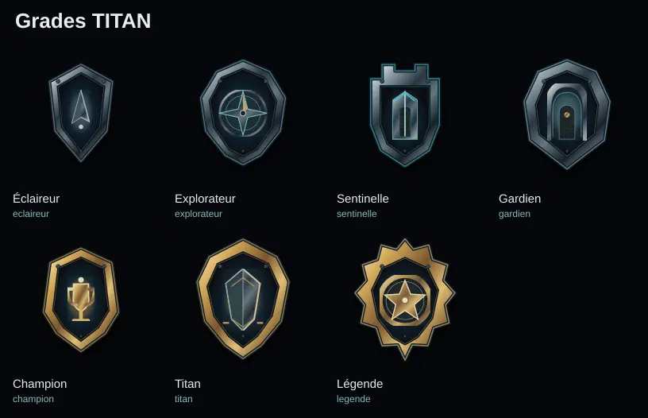
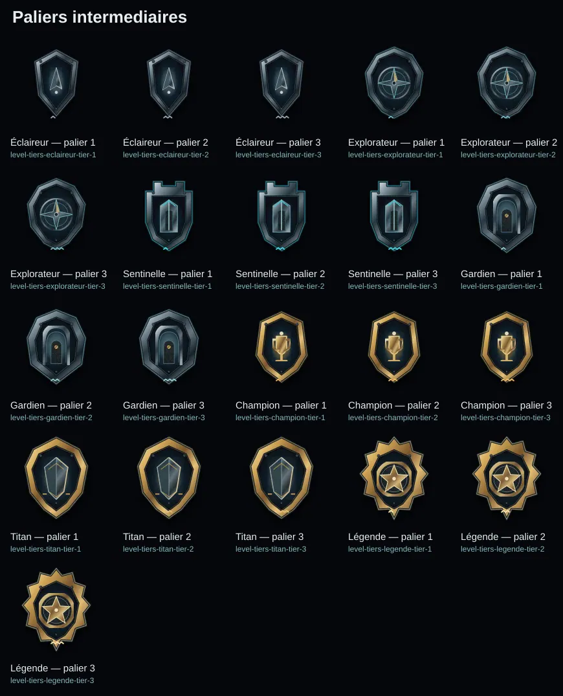
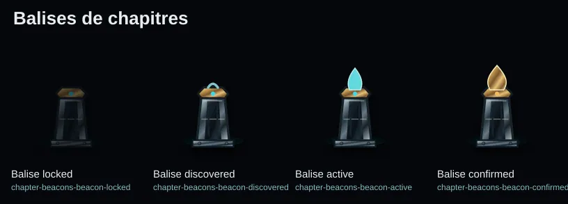
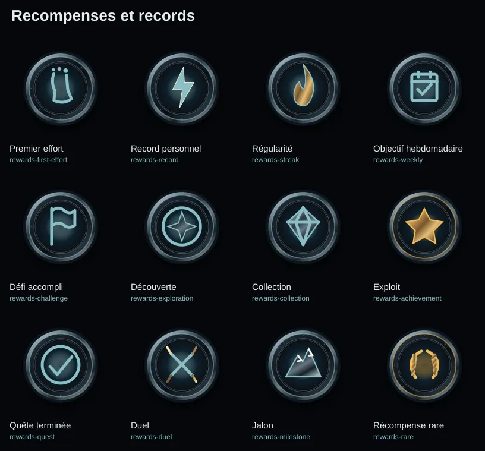
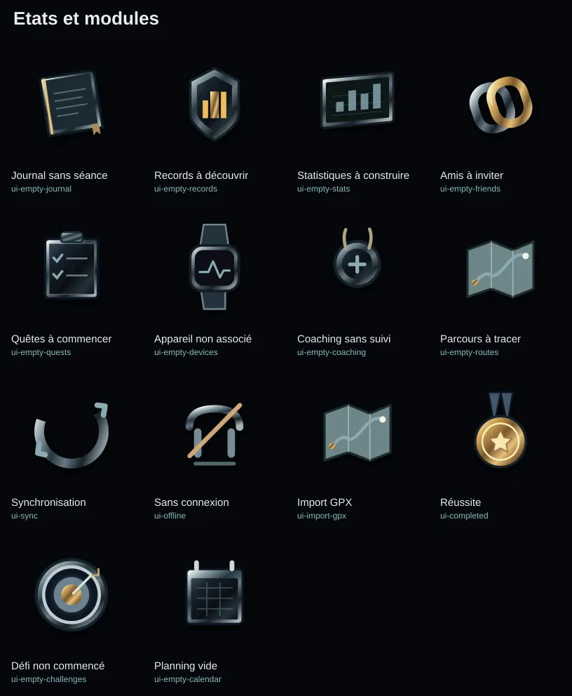
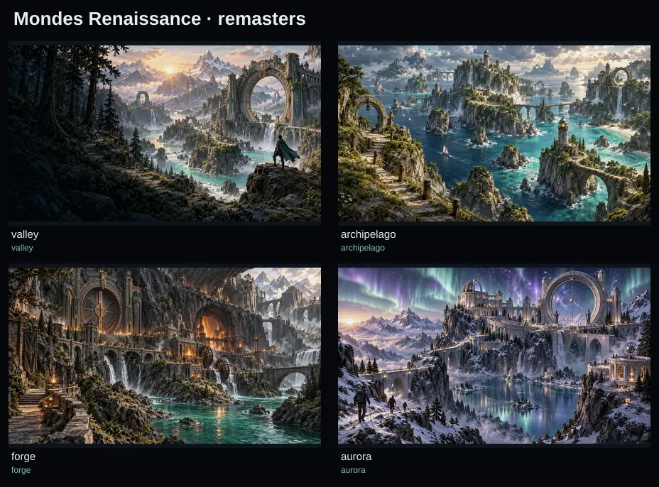
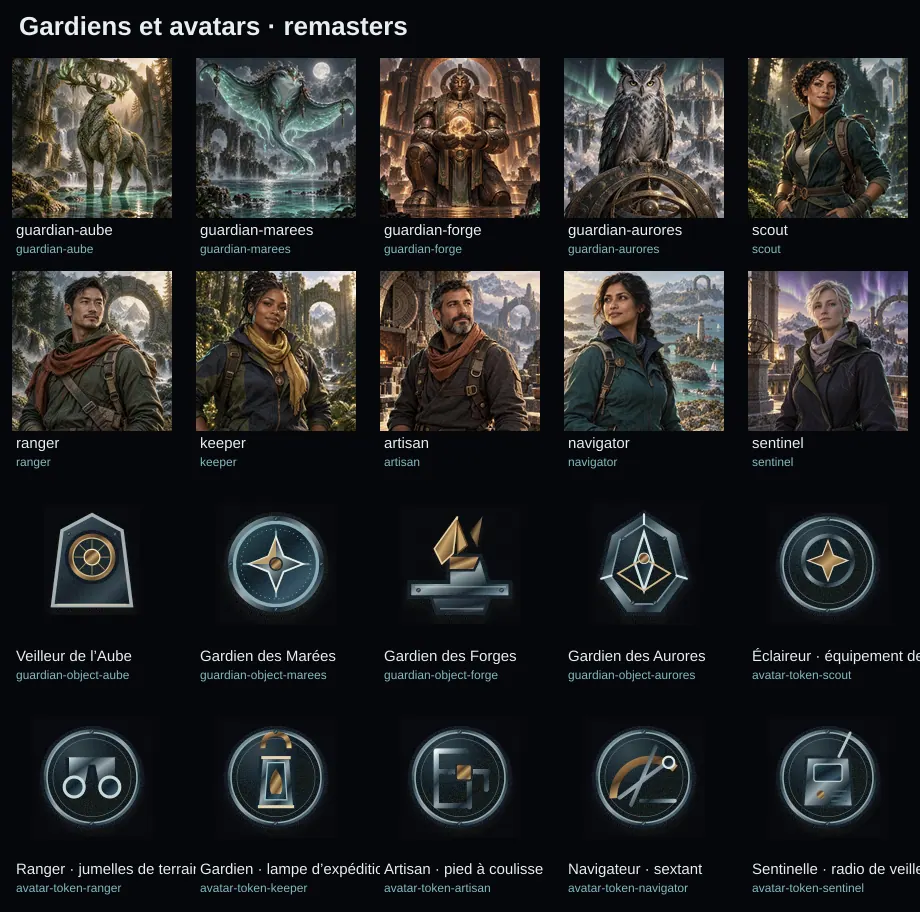
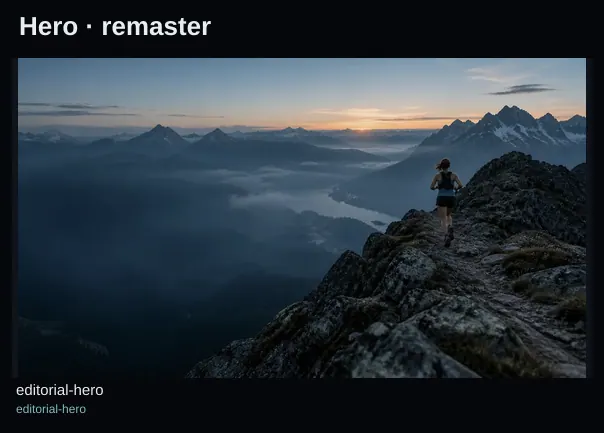

# TITAN — Galerie globale v2

**PROPOSED — approbation requise. Aucun asset integre au code ni deploye.**

Originals vectoriels: 58 | Retouches des visuels existants: 15 | PNG: 73 | WebP: 146

## Grades TITAN

- [ranks-eclaireur](../proposed/masters/ranks/eclaireur.svg) — Éclaireur — **proposed** — [export](../proposed/exports/ranks/eclaireur-512.png) [export](../proposed/exports/ranks/eclaireur-256.webp) [export](../proposed/exports/ranks/eclaireur-96.webp)
- [ranks-explorateur](../proposed/masters/ranks/explorateur.svg) — Explorateur — **proposed** — [export](../proposed/exports/ranks/explorateur-512.png) [export](../proposed/exports/ranks/explorateur-256.webp) [export](../proposed/exports/ranks/explorateur-96.webp)
- [ranks-sentinelle](../proposed/masters/ranks/sentinelle.svg) — Sentinelle — **proposed** — [export](../proposed/exports/ranks/sentinelle-512.png) [export](../proposed/exports/ranks/sentinelle-256.webp) [export](../proposed/exports/ranks/sentinelle-96.webp)
- [ranks-gardien](../proposed/masters/ranks/gardien.svg) — Gardien — **proposed** — [export](../proposed/exports/ranks/gardien-512.png) [export](../proposed/exports/ranks/gardien-256.webp) [export](../proposed/exports/ranks/gardien-96.webp)
- [ranks-champion](../proposed/masters/ranks/champion.svg) — Champion — **proposed** — [export](../proposed/exports/ranks/champion-512.png) [export](../proposed/exports/ranks/champion-256.webp) [export](../proposed/exports/ranks/champion-96.webp)
- [ranks-titan](../proposed/masters/ranks/titan.svg) — Titan — **proposed** — [export](../proposed/exports/ranks/titan-512.png) [export](../proposed/exports/ranks/titan-256.webp) [export](../proposed/exports/ranks/titan-96.webp)
- [ranks-legende](../proposed/masters/ranks/legende.svg) — Légende — **proposed** — [export](../proposed/exports/ranks/legende-512.png) [export](../proposed/exports/ranks/legende-256.webp) [export](../proposed/exports/ranks/legende-96.webp)

## Paliers intermediaires

- [level-tiers-eclaireur-tier-1](../proposed/masters/level-tiers/eclaireur-tier-1.svg) — Éclaireur — palier 1 — **proposed** — [export](../proposed/exports/level-tiers/eclaireur-tier-1-512.png) [export](../proposed/exports/level-tiers/eclaireur-tier-1-256.webp) [export](../proposed/exports/level-tiers/eclaireur-tier-1-96.webp)
- [level-tiers-eclaireur-tier-2](../proposed/masters/level-tiers/eclaireur-tier-2.svg) — Éclaireur — palier 2 — **proposed** — [export](../proposed/exports/level-tiers/eclaireur-tier-2-512.png) [export](../proposed/exports/level-tiers/eclaireur-tier-2-256.webp) [export](../proposed/exports/level-tiers/eclaireur-tier-2-96.webp)
- [level-tiers-eclaireur-tier-3](../proposed/masters/level-tiers/eclaireur-tier-3.svg) — Éclaireur — palier 3 — **proposed** — [export](../proposed/exports/level-tiers/eclaireur-tier-3-512.png) [export](../proposed/exports/level-tiers/eclaireur-tier-3-256.webp) [export](../proposed/exports/level-tiers/eclaireur-tier-3-96.webp)
- [level-tiers-explorateur-tier-1](../proposed/masters/level-tiers/explorateur-tier-1.svg) — Explorateur — palier 1 — **proposed** — [export](../proposed/exports/level-tiers/explorateur-tier-1-512.png) [export](../proposed/exports/level-tiers/explorateur-tier-1-256.webp) [export](../proposed/exports/level-tiers/explorateur-tier-1-96.webp)
- [level-tiers-explorateur-tier-2](../proposed/masters/level-tiers/explorateur-tier-2.svg) — Explorateur — palier 2 — **proposed** — [export](../proposed/exports/level-tiers/explorateur-tier-2-512.png) [export](../proposed/exports/level-tiers/explorateur-tier-2-256.webp) [export](../proposed/exports/level-tiers/explorateur-tier-2-96.webp)
- [level-tiers-explorateur-tier-3](../proposed/masters/level-tiers/explorateur-tier-3.svg) — Explorateur — palier 3 — **proposed** — [export](../proposed/exports/level-tiers/explorateur-tier-3-512.png) [export](../proposed/exports/level-tiers/explorateur-tier-3-256.webp) [export](../proposed/exports/level-tiers/explorateur-tier-3-96.webp)
- [level-tiers-sentinelle-tier-1](../proposed/masters/level-tiers/sentinelle-tier-1.svg) — Sentinelle — palier 1 — **proposed** — [export](../proposed/exports/level-tiers/sentinelle-tier-1-512.png) [export](../proposed/exports/level-tiers/sentinelle-tier-1-256.webp) [export](../proposed/exports/level-tiers/sentinelle-tier-1-96.webp)
- [level-tiers-sentinelle-tier-2](../proposed/masters/level-tiers/sentinelle-tier-2.svg) — Sentinelle — palier 2 — **proposed** — [export](../proposed/exports/level-tiers/sentinelle-tier-2-512.png) [export](../proposed/exports/level-tiers/sentinelle-tier-2-256.webp) [export](../proposed/exports/level-tiers/sentinelle-tier-2-96.webp)
- [level-tiers-sentinelle-tier-3](../proposed/masters/level-tiers/sentinelle-tier-3.svg) — Sentinelle — palier 3 — **proposed** — [export](../proposed/exports/level-tiers/sentinelle-tier-3-512.png) [export](../proposed/exports/level-tiers/sentinelle-tier-3-256.webp) [export](../proposed/exports/level-tiers/sentinelle-tier-3-96.webp)
- [level-tiers-gardien-tier-1](../proposed/masters/level-tiers/gardien-tier-1.svg) — Gardien — palier 1 — **proposed** — [export](../proposed/exports/level-tiers/gardien-tier-1-512.png) [export](../proposed/exports/level-tiers/gardien-tier-1-256.webp) [export](../proposed/exports/level-tiers/gardien-tier-1-96.webp)
- [level-tiers-gardien-tier-2](../proposed/masters/level-tiers/gardien-tier-2.svg) — Gardien — palier 2 — **proposed** — [export](../proposed/exports/level-tiers/gardien-tier-2-512.png) [export](../proposed/exports/level-tiers/gardien-tier-2-256.webp) [export](../proposed/exports/level-tiers/gardien-tier-2-96.webp)
- [level-tiers-gardien-tier-3](../proposed/masters/level-tiers/gardien-tier-3.svg) — Gardien — palier 3 — **proposed** — [export](../proposed/exports/level-tiers/gardien-tier-3-512.png) [export](../proposed/exports/level-tiers/gardien-tier-3-256.webp) [export](../proposed/exports/level-tiers/gardien-tier-3-96.webp)
- [level-tiers-champion-tier-1](../proposed/masters/level-tiers/champion-tier-1.svg) — Champion — palier 1 — **proposed** — [export](../proposed/exports/level-tiers/champion-tier-1-512.png) [export](../proposed/exports/level-tiers/champion-tier-1-256.webp) [export](../proposed/exports/level-tiers/champion-tier-1-96.webp)
- [level-tiers-champion-tier-2](../proposed/masters/level-tiers/champion-tier-2.svg) — Champion — palier 2 — **proposed** — [export](../proposed/exports/level-tiers/champion-tier-2-512.png) [export](../proposed/exports/level-tiers/champion-tier-2-256.webp) [export](../proposed/exports/level-tiers/champion-tier-2-96.webp)
- [level-tiers-champion-tier-3](../proposed/masters/level-tiers/champion-tier-3.svg) — Champion — palier 3 — **proposed** — [export](../proposed/exports/level-tiers/champion-tier-3-512.png) [export](../proposed/exports/level-tiers/champion-tier-3-256.webp) [export](../proposed/exports/level-tiers/champion-tier-3-96.webp)
- [level-tiers-titan-tier-1](../proposed/masters/level-tiers/titan-tier-1.svg) — Titan — palier 1 — **proposed** — [export](../proposed/exports/level-tiers/titan-tier-1-512.png) [export](../proposed/exports/level-tiers/titan-tier-1-256.webp) [export](../proposed/exports/level-tiers/titan-tier-1-96.webp)
- [level-tiers-titan-tier-2](../proposed/masters/level-tiers/titan-tier-2.svg) — Titan — palier 2 — **proposed** — [export](../proposed/exports/level-tiers/titan-tier-2-512.png) [export](../proposed/exports/level-tiers/titan-tier-2-256.webp) [export](../proposed/exports/level-tiers/titan-tier-2-96.webp)
- [level-tiers-titan-tier-3](../proposed/masters/level-tiers/titan-tier-3.svg) — Titan — palier 3 — **proposed** — [export](../proposed/exports/level-tiers/titan-tier-3-512.png) [export](../proposed/exports/level-tiers/titan-tier-3-256.webp) [export](../proposed/exports/level-tiers/titan-tier-3-96.webp)
- [level-tiers-legende-tier-1](../proposed/masters/level-tiers/legende-tier-1.svg) — Légende — palier 1 — **proposed** — [export](../proposed/exports/level-tiers/legende-tier-1-512.png) [export](../proposed/exports/level-tiers/legende-tier-1-256.webp) [export](../proposed/exports/level-tiers/legende-tier-1-96.webp)
- [level-tiers-legende-tier-2](../proposed/masters/level-tiers/legende-tier-2.svg) — Légende — palier 2 — **proposed** — [export](../proposed/exports/level-tiers/legende-tier-2-512.png) [export](../proposed/exports/level-tiers/legende-tier-2-256.webp) [export](../proposed/exports/level-tiers/legende-tier-2-96.webp)
- [level-tiers-legende-tier-3](../proposed/masters/level-tiers/legende-tier-3.svg) — Légende — palier 3 — **proposed** — [export](../proposed/exports/level-tiers/legende-tier-3-512.png) [export](../proposed/exports/level-tiers/legende-tier-3-256.webp) [export](../proposed/exports/level-tiers/legende-tier-3-96.webp)

## Balises de chapitres

- [chapter-beacons-beacon-locked](../proposed/masters/chapter-beacons/beacon-locked.svg) — Balise locked — **proposed** — [export](../proposed/exports/chapter-beacons/beacon-locked-512.png) [export](../proposed/exports/chapter-beacons/beacon-locked-256.webp) [export](../proposed/exports/chapter-beacons/beacon-locked-96.webp)
- [chapter-beacons-beacon-discovered](../proposed/masters/chapter-beacons/beacon-discovered.svg) — Balise discovered — **proposed** — [export](../proposed/exports/chapter-beacons/beacon-discovered-512.png) [export](../proposed/exports/chapter-beacons/beacon-discovered-256.webp) [export](../proposed/exports/chapter-beacons/beacon-discovered-96.webp)
- [chapter-beacons-beacon-active](../proposed/masters/chapter-beacons/beacon-active.svg) — Balise active — **proposed** — [export](../proposed/exports/chapter-beacons/beacon-active-512.png) [export](../proposed/exports/chapter-beacons/beacon-active-256.webp) [export](../proposed/exports/chapter-beacons/beacon-active-96.webp)
- [chapter-beacons-beacon-confirmed](../proposed/masters/chapter-beacons/beacon-confirmed.svg) — Balise confirmed — **proposed** — [export](../proposed/exports/chapter-beacons/beacon-confirmed-512.png) [export](../proposed/exports/chapter-beacons/beacon-confirmed-256.webp) [export](../proposed/exports/chapter-beacons/beacon-confirmed-96.webp)

## Recompenses et records

- [rewards-first-effort](../proposed/masters/rewards/first-effort.svg) — Premier effort — **proposed** — [export](../proposed/exports/rewards/first-effort-512.png) [export](../proposed/exports/rewards/first-effort-256.webp) [export](../proposed/exports/rewards/first-effort-96.webp)
- [rewards-record](../proposed/masters/rewards/record.svg) — Record personnel — **proposed** — [export](../proposed/exports/rewards/record-512.png) [export](../proposed/exports/rewards/record-256.webp) [export](../proposed/exports/rewards/record-96.webp)
- [rewards-streak](../proposed/masters/rewards/streak.svg) — Régularité — **proposed** — [export](../proposed/exports/rewards/streak-512.png) [export](../proposed/exports/rewards/streak-256.webp) [export](../proposed/exports/rewards/streak-96.webp)
- [rewards-weekly](../proposed/masters/rewards/weekly.svg) — Objectif hebdomadaire — **proposed** — [export](../proposed/exports/rewards/weekly-512.png) [export](../proposed/exports/rewards/weekly-256.webp) [export](../proposed/exports/rewards/weekly-96.webp)
- [rewards-challenge](../proposed/masters/rewards/challenge.svg) — Défi accompli — **proposed** — [export](../proposed/exports/rewards/challenge-512.png) [export](../proposed/exports/rewards/challenge-256.webp) [export](../proposed/exports/rewards/challenge-96.webp)
- [rewards-exploration](../proposed/masters/rewards/exploration.svg) — Découverte — **proposed** — [export](../proposed/exports/rewards/exploration-512.png) [export](../proposed/exports/rewards/exploration-256.webp) [export](../proposed/exports/rewards/exploration-96.webp)
- [rewards-collection](../proposed/masters/rewards/collection.svg) — Collection — **proposed** — [export](../proposed/exports/rewards/collection-512.png) [export](../proposed/exports/rewards/collection-256.webp) [export](../proposed/exports/rewards/collection-96.webp)
- [rewards-achievement](../proposed/masters/rewards/achievement.svg) — Exploit — **proposed** — [export](../proposed/exports/rewards/achievement-512.png) [export](../proposed/exports/rewards/achievement-256.webp) [export](../proposed/exports/rewards/achievement-96.webp)
- [rewards-quest](../proposed/masters/rewards/quest.svg) — Quête terminée — **proposed** — [export](../proposed/exports/rewards/quest-512.png) [export](../proposed/exports/rewards/quest-256.webp) [export](../proposed/exports/rewards/quest-96.webp)
- [rewards-duel](../proposed/masters/rewards/duel.svg) — Duel — **proposed** — [export](../proposed/exports/rewards/duel-512.png) [export](../proposed/exports/rewards/duel-256.webp) [export](../proposed/exports/rewards/duel-96.webp)
- [rewards-milestone](../proposed/masters/rewards/milestone.svg) — Jalon — **proposed** — [export](../proposed/exports/rewards/milestone-512.png) [export](../proposed/exports/rewards/milestone-256.webp) [export](../proposed/exports/rewards/milestone-96.webp)
- [rewards-rare](../proposed/masters/rewards/rare.svg) — Récompense rare — **proposed** — [export](../proposed/exports/rewards/rare-512.png) [export](../proposed/exports/rewards/rare-256.webp) [export](../proposed/exports/rewards/rare-96.webp)

## Etats et modules

- [ui-empty-journal](../proposed/masters/ui/empty-journal.svg) — Journal sans séance — **proposed** — [export](../proposed/exports/ui/empty-journal-512.png) [export](../proposed/exports/ui/empty-journal-256.webp) [export](../proposed/exports/ui/empty-journal-96.webp)
- [ui-empty-records](../proposed/masters/ui/empty-records.svg) — Records à découvrir — **proposed** — [export](../proposed/exports/ui/empty-records-512.png) [export](../proposed/exports/ui/empty-records-256.webp) [export](../proposed/exports/ui/empty-records-96.webp)
- [ui-empty-stats](../proposed/masters/ui/empty-stats.svg) — Statistiques à construire — **proposed** — [export](../proposed/exports/ui/empty-stats-512.png) [export](../proposed/exports/ui/empty-stats-256.webp) [export](../proposed/exports/ui/empty-stats-96.webp)
- [ui-empty-friends](../proposed/masters/ui/empty-friends.svg) — Amis à inviter — **proposed** — [export](../proposed/exports/ui/empty-friends-512.png) [export](../proposed/exports/ui/empty-friends-256.webp) [export](../proposed/exports/ui/empty-friends-96.webp)
- [ui-empty-quests](../proposed/masters/ui/empty-quests.svg) — Quêtes à commencer — **proposed** — [export](../proposed/exports/ui/empty-quests-512.png) [export](../proposed/exports/ui/empty-quests-256.webp) [export](../proposed/exports/ui/empty-quests-96.webp)
- [ui-empty-devices](../proposed/masters/ui/empty-devices.svg) — Appareil non associé — **proposed** — [export](../proposed/exports/ui/empty-devices-512.png) [export](../proposed/exports/ui/empty-devices-256.webp) [export](../proposed/exports/ui/empty-devices-96.webp)
- [ui-empty-coaching](../proposed/masters/ui/empty-coaching.svg) — Coaching sans suivi — **proposed** — [export](../proposed/exports/ui/empty-coaching-512.png) [export](../proposed/exports/ui/empty-coaching-256.webp) [export](../proposed/exports/ui/empty-coaching-96.webp)
- [ui-empty-routes](../proposed/masters/ui/empty-routes.svg) — Parcours à tracer — **proposed** — [export](../proposed/exports/ui/empty-routes-512.png) [export](../proposed/exports/ui/empty-routes-256.webp) [export](../proposed/exports/ui/empty-routes-96.webp)
- [ui-sync](../proposed/masters/ui/sync.svg) — Synchronisation — **proposed** — [export](../proposed/exports/ui/sync-512.png) [export](../proposed/exports/ui/sync-256.webp) [export](../proposed/exports/ui/sync-96.webp)
- [ui-offline](../proposed/masters/ui/offline.svg) — Sans connexion — **proposed** — [export](../proposed/exports/ui/offline-512.png) [export](../proposed/exports/ui/offline-256.webp) [export](../proposed/exports/ui/offline-96.webp)
- [ui-import-gpx](../proposed/masters/ui/import-gpx.svg) — Import GPX — **proposed** — [export](../proposed/exports/ui/import-gpx-512.png) [export](../proposed/exports/ui/import-gpx-256.webp) [export](../proposed/exports/ui/import-gpx-96.webp)
- [ui-completed](../proposed/masters/ui/completed.svg) — Réussite — **proposed** — [export](../proposed/exports/ui/completed-512.png) [export](../proposed/exports/ui/completed-256.webp) [export](../proposed/exports/ui/completed-96.webp)
- [ui-empty-challenges](../proposed/masters/ui/empty-challenges.svg) — Défi non commencé — **proposed** — [export](../proposed/exports/ui/empty-challenges-512.png) [export](../proposed/exports/ui/empty-challenges-256.webp) [export](../proposed/exports/ui/empty-challenges-96.webp)
- [ui-empty-calendar](../proposed/masters/ui/empty-calendar.svg) — Planning vide — **proposed** — [export](../proposed/exports/ui/empty-calendar-512.png) [export](../proposed/exports/ui/empty-calendar-256.webp) [export](../proposed/exports/ui/empty-calendar-96.webp)

## Mondes Renaissance · remasters

- [valley](../proposed/masters/renaissance/valley.png) — valley — **proposed** — [export](../proposed/exports/renaissance/valley-web.webp) [export](../proposed/exports/renaissance/valley-android.webp)
- [archipelago](../proposed/masters/renaissance/archipelago.png) — archipelago — **proposed** — [export](../proposed/exports/renaissance/archipelago-web.webp) [export](../proposed/exports/renaissance/archipelago-android.webp)
- [forge](../proposed/masters/renaissance/forge.png) — forge — **proposed** — [export](../proposed/exports/renaissance/forge-web.webp) [export](../proposed/exports/renaissance/forge-android.webp)
- [aurora](../proposed/masters/renaissance/aurora.png) — aurora — **proposed** — [export](../proposed/exports/renaissance/aurora-web.webp) [export](../proposed/exports/renaissance/aurora-android.webp)

## Gardiens et avatars · remasters

- [guardian-aube](../proposed/masters/renaissance/guardian-aube.png) — guardian-aube — **proposed** — [export](../proposed/exports/renaissance/guardian-aube-web.webp) [export](../proposed/exports/renaissance/guardian-aube-android.webp)
- [guardian-marees](../proposed/masters/renaissance/guardian-marees.png) — guardian-marees — **proposed** — [export](../proposed/exports/renaissance/guardian-marees-web.webp) [export](../proposed/exports/renaissance/guardian-marees-android.webp)
- [guardian-forge](../proposed/masters/renaissance/guardian-forge.png) — guardian-forge — **proposed** — [export](../proposed/exports/renaissance/guardian-forge-web.webp) [export](../proposed/exports/renaissance/guardian-forge-android.webp)
- [guardian-aurores](../proposed/masters/renaissance/guardian-aurores.png) — guardian-aurores — **proposed** — [export](../proposed/exports/renaissance/guardian-aurores-web.webp) [export](../proposed/exports/renaissance/guardian-aurores-android.webp)
- [scout](../proposed/masters/renaissance/scout.png) — scout — **proposed** — [export](../proposed/exports/renaissance/scout-web.webp) [export](../proposed/exports/renaissance/scout-android.webp)
- [ranger](../proposed/masters/renaissance/ranger.png) — ranger — **proposed** — [export](../proposed/exports/renaissance/ranger-web.webp) [export](../proposed/exports/renaissance/ranger-android.webp)
- [keeper](../proposed/masters/renaissance/keeper.png) — keeper — **proposed** — [export](../proposed/exports/renaissance/keeper-web.webp) [export](../proposed/exports/renaissance/keeper-android.webp)
- [artisan](../proposed/masters/renaissance/artisan.png) — artisan — **proposed** — [export](../proposed/exports/renaissance/artisan-web.webp) [export](../proposed/exports/renaissance/artisan-android.webp)
- [navigator](../proposed/masters/renaissance/navigator.png) — navigator — **proposed** — [export](../proposed/exports/renaissance/navigator-web.webp) [export](../proposed/exports/renaissance/navigator-android.webp)
- [sentinel](../proposed/masters/renaissance/sentinel.png) — sentinel — **proposed** — [export](../proposed/exports/renaissance/sentinel-web.webp) [export](../proposed/exports/renaissance/sentinel-android.webp)

## Hero · remaster

- [editorial-hero](../proposed/masters/renaissance/editorial-hero.png) — editorial-hero — **proposed** — [export](../proposed/exports/renaissance/editorial-hero-web.webp) [export](../proposed/exports/renaissance/editorial-hero-android.webp)

## Portee et limites

Les retouches Renaissance sont des retraitements des images deja presentes, et NON de nouvelles scenes originales.
Les changements restent exclusivement dans le dossier de propositions; le code Web/Android, les forfaits, logos et pictogrammes sportifs ne sont pas modifies.
Les validations automatiques ne prouvent pas la qualite esthetique ni la visualisation sur un vrai telephone.
