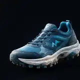
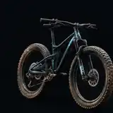
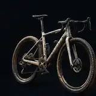
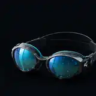
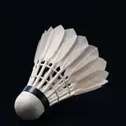
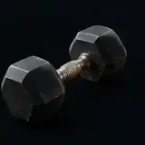
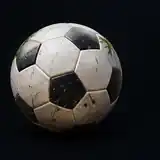
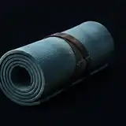

# Lot 01 — 10 pictogrammes 3D sportifs

**Approuvé pour la bibliothèque le 12/11/2026 ; non intégré à l'application.**

| Nº | Aperçu | Sport | ID |
|:--:|:--:|---|---|
| 01 |  | Course à pied | `SPT-01` |
| 02 |  | VTT | `SPT-02` |
| 03 |  | Gravel | `SPT-03` |
| 04 |  | Natation | `SPT-04` |
| 05 |  | Badminton | `SPT-05` |
| 06 |  | Escalade | `SPT-06` |
| 07 |  | Musculation | `SPT-07` |
| 08 |  | Football | `SPT-08` |
| 09 |  | Yoga | `SPT-09` |
| 10 |  | Kayak | `SPT-10` |

## Provenance et caractéristiques
Dix recadrages indépendants provenant de la **planche 3D sans personnages approuvée dans la conversation de direction artistique TITAN**. Les PNG du rendu initial ne sont pas des objets individuels avec alpha ; ces WebP sont des recadrages optimisés de 160 × 160 px, fond bleu-noir inclus, adaptés à un premier usage mobile compact. 

Les équivalents natifs haute résolution, la transparence et le raccordement exact aux identifiants des 260 sports restent à traiter lors de l'intégration. Aucun visuel d'abonnement n'a été touché.

Pour toute nouvelle déclinaison, appliquer [la charte](../../CHARTER.md) et [les instructions Work](../../INSTRUCTIONS-WORK.md).
