# TITAN — Sports 3D, lot 02 (11–60)

**48 pictogrammes conservés pour la bibliothèque, non intégrés à l'application.**

- `MASTER-LOT-02.png` : planche source approuvée, conservée intacte.
- `icons/` : 48 fichiers individuels WebP, numérotés, 160×160px, fond sombre intégré.
- `registry.json` : identifiants de travail, libellés, chemins, SHA-256 et statut.

## Catalogue

| N° | Sport | Asset |
|---:|---|---|
| 11 | Basketball | 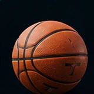 |
| 12 | Tennis | 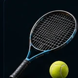 |
| 13 | Volleyball | 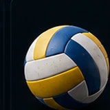 |
| 14 | Handball | 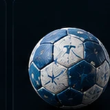 |
| 15 | Rugby | 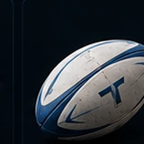 |
| 16 | Golf | 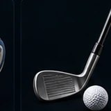 |
| 17 | Tennis de table | 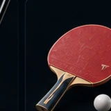 |
| 18 | Squash | 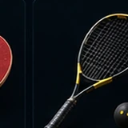 |
| 19 | Padel | 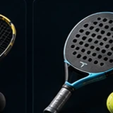 |
| 20 | Boxe | 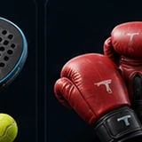 |
| 21 | Judo | 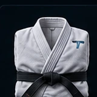 |
| 22 | Karaté | 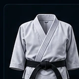 |
| 23 | Taekwondo | 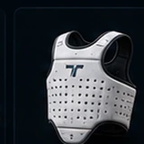 |
| 24 | Lutte | 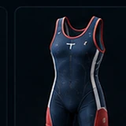 |
| 25 | Escrime | 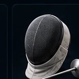 |
| 26 | Haltérophilie | 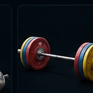 |
| 27 | Pilates | 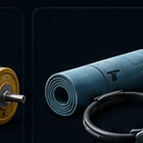 |
| 28 | Danse | 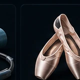 |
| 29 | Trail | 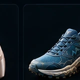 |
| 30 | Cyclisme sur route | 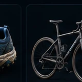 |
| 31 | BMX | 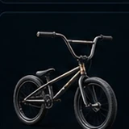 |
| 32 | Cyclo-cross | 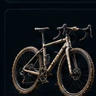 |
| 33 | Triathlon | 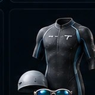 |
| 34 | Aviron | 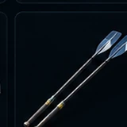 |
| 36 | Stand up paddle | 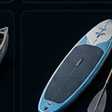 |
| 37 | Surf | 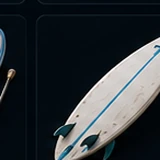 |
| 38 | Planche à voile | 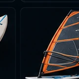 |
| 39 | Kitesurf | 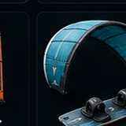 |
| 40 | Plongée | 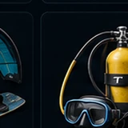 |
| 41 | Water-polo | 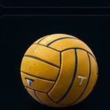 |
| 42 | Voile | 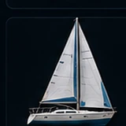 |
| 43 | Ski alpin | 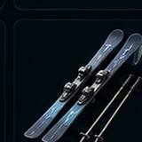 |
| 44 | Ski de fond | 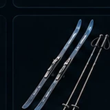 |
| 45 | Snowboard | 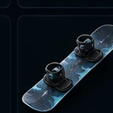 |
| 46 | Biathlon | 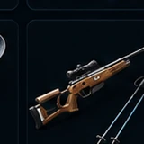 |
| 47 | Patinage | 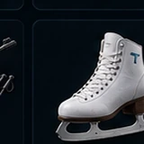 |
| 48 | Roller | 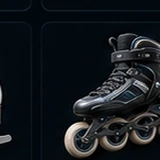 |
| 49 | Skateboard | 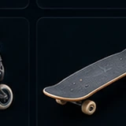 |
| 51 | Parkour | 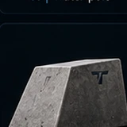 |
| 52 | Tir à l’arc | 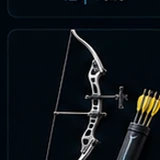 |
| 53 | Tir sportif | 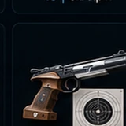 |
| 54 | Base-ball | 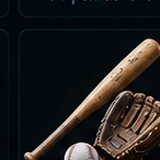 |
| 55 | Softball | 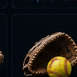 |
| 56 | Hockey sur glace | 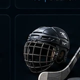 |
| 57 | Hockey sur gazon | 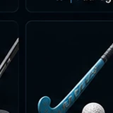 |
| 58 | Gymnastique | 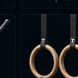 |
| 59 | Trampoline | 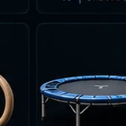 |
| 60 | Équitation | 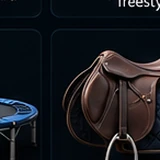 |

## Consignes d'usage

- Ces objets ont été **extraits de la planche source** ; ce ne sont pas 50 rendus individuels haute définition ni des modèles 3D éditables.
- Conserver le fond sombre, ne pas prétendre que les WebP sont transparents.
- Valider la lisibilité finale sur Android : 32/48/64px. Les sports visuellement proches méritent une attention particulière.
- Mapper les IDs du vrai catalogue TITAN avant implémentation. Ne pas supposer que le slug est l'identifiant interne du sport.
- Ne pas modifier la section abonnements.
- Aucun déploiement ni modification UI ne résulte de cet ajout.

> **Nettoyage 12/11/2026 :** les deux images hors catalogue `35-canoe.webp` et `50-trottinette-freestyle.webp` ont été retirées. Les autres anciennes variantes restent disponibles jusqu'à remplacement vérifié. Voir [migration visuelle](../visual-refresh-2026-11-12/README.md).
